<!-- Generated by tools/build_profile.py from tools/README.template.md. Edit the template, not this file. -->
<a href="https://johnbjoseph-cybersec.github.io/"><picture><source media="(max-width: 600px) and (prefers-color-scheme: dark)" srcset="https://raw.githubusercontent.com/Johnbjoseph-cybersec/Johnbjoseph-cybersec/main/assets/dark/hero-m.svg?v=1bdbb05e"><source media="(max-width: 600px)" srcset="https://raw.githubusercontent.com/Johnbjoseph-cybersec/Johnbjoseph-cybersec/main/assets/light/hero-m.svg?v=f7fe5f66"><source media="(prefers-color-scheme: dark)" srcset="https://raw.githubusercontent.com/Johnbjoseph-cybersec/Johnbjoseph-cybersec/main/assets/dark/hero.svg?v=d93078c9"></picture></a>

<a href="https://www.linkedin.com/newsletters/grc-made-simple-7493284804747251713/"><picture><source media="(max-width: 600px) and (prefers-color-scheme: dark)" srcset="https://raw.githubusercontent.com/Johnbjoseph-cybersec/Johnbjoseph-cybersec/main/assets/dark/pill-newsletter-m.svg?v=f723385b"><source media="(max-width: 600px)" srcset="https://raw.githubusercontent.com/Johnbjoseph-cybersec/Johnbjoseph-cybersec/main/assets/light/pill-newsletter-m.svg?v=ca740410"><source media="(prefers-color-scheme: dark)" srcset="https://raw.githubusercontent.com/Johnbjoseph-cybersec/Johnbjoseph-cybersec/main/assets/dark/pill-newsletter.svg?v=34dfb24a"></picture></a><a href="https://johnbjoseph-cybersec.github.io/"><picture><source media="(max-width: 600px) and (prefers-color-scheme: dark)" srcset="https://raw.githubusercontent.com/Johnbjoseph-cybersec/Johnbjoseph-cybersec/main/assets/dark/pill-website-m.svg?v=f279c48a"><source media="(max-width: 600px)" srcset="https://raw.githubusercontent.com/Johnbjoseph-cybersec/Johnbjoseph-cybersec/main/assets/light/pill-website-m.svg?v=2d9f1d57"><source media="(prefers-color-scheme: dark)" srcset="https://raw.githubusercontent.com/Johnbjoseph-cybersec/Johnbjoseph-cybersec/main/assets/dark/pill-website.svg?v=17d76159"></picture></a><a href="https://grclab.purplecop.io"><picture><source media="(max-width: 600px) and (prefers-color-scheme: dark)" srcset="https://raw.githubusercontent.com/Johnbjoseph-cybersec/Johnbjoseph-cybersec/main/assets/dark/pill-lab-m.svg?v=60ca53e1"><source media="(max-width: 600px)" srcset="https://raw.githubusercontent.com/Johnbjoseph-cybersec/Johnbjoseph-cybersec/main/assets/light/pill-lab-m.svg?v=e233b4ee"><source media="(prefers-color-scheme: dark)" srcset="https://raw.githubusercontent.com/Johnbjoseph-cybersec/Johnbjoseph-cybersec/main/assets/dark/pill-lab.svg?v=99d15893"></picture></a><a href="https://www.youtube.com/@GRCMadeSimple"><picture><source media="(max-width: 600px) and (prefers-color-scheme: dark)" srcset="https://raw.githubusercontent.com/Johnbjoseph-cybersec/Johnbjoseph-cybersec/main/assets/dark/pill-youtube-m.svg?v=c316ab88"><source media="(max-width: 600px)" srcset="https://raw.githubusercontent.com/Johnbjoseph-cybersec/Johnbjoseph-cybersec/main/assets/light/pill-youtube-m.svg?v=31c6e273"><source media="(prefers-color-scheme: dark)" srcset="https://raw.githubusercontent.com/Johnbjoseph-cybersec/Johnbjoseph-cybersec/main/assets/dark/pill-youtube.svg?v=e571267f"></picture></a><a href="https://www.linkedin.com/in/john-bj/"><picture><source media="(max-width: 600px) and (prefers-color-scheme: dark)" srcset="https://raw.githubusercontent.com/Johnbjoseph-cybersec/Johnbjoseph-cybersec/main/assets/dark/pill-linkedin-m.svg?v=e3ce64b6"><source media="(max-width: 600px)" srcset="https://raw.githubusercontent.com/Johnbjoseph-cybersec/Johnbjoseph-cybersec/main/assets/light/pill-linkedin-m.svg?v=97170b6c"><source media="(prefers-color-scheme: dark)" srcset="https://raw.githubusercontent.com/Johnbjoseph-cybersec/Johnbjoseph-cybersec/main/assets/dark/pill-linkedin.svg?v=2140f608"></picture></a>

<picture><source media="(max-width: 600px) and (prefers-color-scheme: dark)" srcset="https://raw.githubusercontent.com/Johnbjoseph-cybersec/Johnbjoseph-cybersec/main/assets/dark/ticker-m.svg?v=ef571a10"><source media="(max-width: 600px)" srcset="https://raw.githubusercontent.com/Johnbjoseph-cybersec/Johnbjoseph-cybersec/main/assets/light/ticker-m.svg?v=44d9d972"><source media="(prefers-color-scheme: dark)" srcset="https://raw.githubusercontent.com/Johnbjoseph-cybersec/Johnbjoseph-cybersec/main/assets/dark/ticker.svg?v=0a1c2138"></picture>

<picture><source media="(max-width: 600px) and (prefers-color-scheme: dark)" srcset="https://raw.githubusercontent.com/Johnbjoseph-cybersec/Johnbjoseph-cybersec/main/assets/dark/sec-work-m.svg?v=085df540"><source media="(max-width: 600px)" srcset="https://raw.githubusercontent.com/Johnbjoseph-cybersec/Johnbjoseph-cybersec/main/assets/light/sec-work-m.svg?v=98df2036"><source media="(prefers-color-scheme: dark)" srcset="https://raw.githubusercontent.com/Johnbjoseph-cybersec/Johnbjoseph-cybersec/main/assets/dark/sec-work.svg?v=4e8458a1"></picture>

<picture><source media="(max-width: 600px) and (prefers-color-scheme: dark)" srcset="https://raw.githubusercontent.com/Johnbjoseph-cybersec/Johnbjoseph-cybersec/main/assets/dark/intro-m.svg?v=5b096b08"><source media="(max-width: 600px)" srcset="https://raw.githubusercontent.com/Johnbjoseph-cybersec/Johnbjoseph-cybersec/main/assets/light/intro-m.svg?v=457e97f5"><source media="(prefers-color-scheme: dark)" srcset="https://raw.githubusercontent.com/Johnbjoseph-cybersec/Johnbjoseph-cybersec/main/assets/dark/intro.svg?v=488b6022"></picture>

  <picture><source media="(prefers-color-scheme: dark)" srcset="https://raw.githubusercontent.com/Johnbjoseph-cybersec/Johnbjoseph-cybersec/main/assets/dark/focus-ai-security.svg?v=9ed16ed1"></picture>
  <picture><source media="(prefers-color-scheme: dark)" srcset="https://raw.githubusercontent.com/Johnbjoseph-cybersec/Johnbjoseph-cybersec/main/assets/dark/focus-ai-governance.svg?v=614d5fb2"></picture>
  <picture><source media="(prefers-color-scheme: dark)" srcset="https://raw.githubusercontent.com/Johnbjoseph-cybersec/Johnbjoseph-cybersec/main/assets/dark/focus-pqc.svg?v=ee9526c7"></picture>
  <picture><source media="(prefers-color-scheme: dark)" srcset="https://raw.githubusercontent.com/Johnbjoseph-cybersec/Johnbjoseph-cybersec/main/assets/dark/focus-grc-eng.svg?v=525e2a35"></picture>

<picture><source media="(max-width: 600px) and (prefers-color-scheme: dark)" srcset="https://raw.githubusercontent.com/Johnbjoseph-cybersec/Johnbjoseph-cybersec/main/assets/dark/sec-oss-m.svg?v=b2ff00cf"><source media="(max-width: 600px)" srcset="https://raw.githubusercontent.com/Johnbjoseph-cybersec/Johnbjoseph-cybersec/main/assets/light/sec-oss-m.svg?v=bc9359f0"><source media="(prefers-color-scheme: dark)" srcset="https://raw.githubusercontent.com/Johnbjoseph-cybersec/Johnbjoseph-cybersec/main/assets/dark/sec-oss.svg?v=5cc4a1a6"></picture>

<picture><source media="(max-width: 600px) and (prefers-color-scheme: dark)" srcset="https://raw.githubusercontent.com/Johnbjoseph-cybersec/Johnbjoseph-cybersec/main/assets/dark/stats-m.svg?v=c87ff8ef"><source media="(max-width: 600px)" srcset="https://raw.githubusercontent.com/Johnbjoseph-cybersec/Johnbjoseph-cybersec/main/assets/light/stats-m.svg?v=849ba027"><source media="(prefers-color-scheme: dark)" srcset="https://raw.githubusercontent.com/Johnbjoseph-cybersec/Johnbjoseph-cybersec/main/assets/dark/stats.svg?v=092cf236"></picture>

<picture><source media="(max-width: 600px) and (prefers-color-scheme: dark)" srcset="https://raw.githubusercontent.com/Johnbjoseph-cybersec/Johnbjoseph-cybersec/main/assets/dark/chart-m.svg?v=07314eba"><source media="(max-width: 600px)" srcset="https://raw.githubusercontent.com/Johnbjoseph-cybersec/Johnbjoseph-cybersec/main/assets/light/chart-m.svg?v=9daa6c57"><source media="(prefers-color-scheme: dark)" srcset="https://raw.githubusercontent.com/Johnbjoseph-cybersec/Johnbjoseph-cybersec/main/assets/dark/chart.svg?v=68de555d"></picture>

<picture><source media="(max-width: 600px) and (prefers-color-scheme: dark)" srcset="https://raw.githubusercontent.com/Johnbjoseph-cybersec/Johnbjoseph-cybersec/main/assets/dark/sub-merged-m.svg?v=a54fc68e"><source media="(max-width: 600px)" srcset="https://raw.githubusercontent.com/Johnbjoseph-cybersec/Johnbjoseph-cybersec/main/assets/light/sub-merged-m.svg?v=46694cf9"><source media="(prefers-color-scheme: dark)" srcset="https://raw.githubusercontent.com/Johnbjoseph-cybersec/Johnbjoseph-cybersec/main/assets/dark/sub-merged.svg?v=07f2e703"></picture>

  <a href="https://security.utexas.edu/hall-of-fame"><picture><source media="(max-width: 600px) and (prefers-color-scheme: dark)" srcset="https://raw.githubusercontent.com/Johnbjoseph-cybersec/Johnbjoseph-cybersec/main/assets/rows/dark/utexas-hof-2026-m.svg?v=a80c3cf5"><source media="(max-width: 600px)" srcset="https://raw.githubusercontent.com/Johnbjoseph-cybersec/Johnbjoseph-cybersec/main/assets/rows/light/utexas-hof-2026-m.svg?v=e59cc2ba"><source media="(prefers-color-scheme: dark)" srcset="https://raw.githubusercontent.com/Johnbjoseph-cybersec/Johnbjoseph-cybersec/main/assets/rows/dark/utexas-hof-2026.svg?v=7e30d102"></picture></a>
  <a href="https://github.com/wshobson/agents/pull/831"><picture><source media="(max-width: 600px) and (prefers-color-scheme: dark)" srcset="https://raw.githubusercontent.com/Johnbjoseph-cybersec/Johnbjoseph-cybersec/main/assets/rows/dark/wshobson-agents-831-m.svg?v=524104c8"><source media="(max-width: 600px)" srcset="https://raw.githubusercontent.com/Johnbjoseph-cybersec/Johnbjoseph-cybersec/main/assets/rows/light/wshobson-agents-831-m.svg?v=10bd6abc"><source media="(prefers-color-scheme: dark)" srcset="https://raw.githubusercontent.com/Johnbjoseph-cybersec/Johnbjoseph-cybersec/main/assets/rows/dark/wshobson-agents-831.svg?v=2dacb2cd"></picture></a>
  <a href="https://github.com/w3c/did-resolution/pull/406"><picture><source media="(max-width: 600px) and (prefers-color-scheme: dark)" srcset="https://raw.githubusercontent.com/Johnbjoseph-cybersec/Johnbjoseph-cybersec/main/assets/rows/dark/w3c-did-resolution-360-m.svg?v=ad35c38f"><source media="(max-width: 600px)" srcset="https://raw.githubusercontent.com/Johnbjoseph-cybersec/Johnbjoseph-cybersec/main/assets/rows/light/w3c-did-resolution-360-m.svg?v=5925d7e4"><source media="(prefers-color-scheme: dark)" srcset="https://raw.githubusercontent.com/Johnbjoseph-cybersec/Johnbjoseph-cybersec/main/assets/rows/dark/w3c-did-resolution-360.svg?v=03fb145c"></picture></a>
  <a href="https://github.com/OWASP/www-project-ai-security-and-privacy-guide/pull/285"><picture><source media="(max-width: 600px) and (prefers-color-scheme: dark)" srcset="https://raw.githubusercontent.com/Johnbjoseph-cybersec/Johnbjoseph-cybersec/main/assets/rows/dark/www-project-ai-security-and-privacy-guide-285-m.svg?v=74a82ff7"><source media="(max-width: 600px)" srcset="https://raw.githubusercontent.com/Johnbjoseph-cybersec/Johnbjoseph-cybersec/main/assets/rows/light/www-project-ai-security-and-privacy-guide-285-m.svg?v=62215881"><source media="(prefers-color-scheme: dark)" srcset="https://raw.githubusercontent.com/Johnbjoseph-cybersec/Johnbjoseph-cybersec/main/assets/rows/dark/www-project-ai-security-and-privacy-guide-285.svg?v=8eb111d3"></picture></a>
  <a href="https://github.com/CycloneDX/specification/pull/1219"><picture><source media="(max-width: 600px) and (prefers-color-scheme: dark)" srcset="https://raw.githubusercontent.com/Johnbjoseph-cybersec/Johnbjoseph-cybersec/main/assets/rows/dark/cyclonedx-spec-1219-m.svg?v=e691eea9"><source media="(max-width: 600px)" srcset="https://raw.githubusercontent.com/Johnbjoseph-cybersec/Johnbjoseph-cybersec/main/assets/rows/light/cyclonedx-spec-1219-m.svg?v=844510ae"><source media="(prefers-color-scheme: dark)" srcset="https://raw.githubusercontent.com/Johnbjoseph-cybersec/Johnbjoseph-cybersec/main/assets/rows/dark/cyclonedx-spec-1219.svg?v=2cab1a18"></picture></a>
  <a href="https://github.com/google/cybernetic-agent-governance-engine/pull/777"><picture><source media="(max-width: 600px) and (prefers-color-scheme: dark)" srcset="https://raw.githubusercontent.com/Johnbjoseph-cybersec/Johnbjoseph-cybersec/main/assets/rows/dark/cybernetic-agent-governance-engine-777-m.svg?v=102b3c49"><source media="(max-width: 600px)" srcset="https://raw.githubusercontent.com/Johnbjoseph-cybersec/Johnbjoseph-cybersec/main/assets/rows/light/cybernetic-agent-governance-engine-777-m.svg?v=4ac1d184"><source media="(prefers-color-scheme: dark)" srcset="https://raw.githubusercontent.com/Johnbjoseph-cybersec/Johnbjoseph-cybersec/main/assets/rows/dark/cybernetic-agent-governance-engine-777.svg?v=5b99483b"></picture></a>
  <a href="https://github.com/msoedov/agentic_security/pull/385"><picture><source media="(max-width: 600px) and (prefers-color-scheme: dark)" srcset="https://raw.githubusercontent.com/Johnbjoseph-cybersec/Johnbjoseph-cybersec/main/assets/rows/dark/agentic_security-385-m.svg?v=d501f99c"><source media="(max-width: 600px)" srcset="https://raw.githubusercontent.com/Johnbjoseph-cybersec/Johnbjoseph-cybersec/main/assets/rows/light/agentic_security-385-m.svg?v=897c6eeb"><source media="(prefers-color-scheme: dark)" srcset="https://raw.githubusercontent.com/Johnbjoseph-cybersec/Johnbjoseph-cybersec/main/assets/rows/dark/agentic_security-385.svg?v=98808deb"></picture></a>
  <a href="https://github.com/Tencent/AI-Infra-Guard/pull/768"><picture><source media="(max-width: 600px) and (prefers-color-scheme: dark)" srcset="https://raw.githubusercontent.com/Johnbjoseph-cybersec/Johnbjoseph-cybersec/main/assets/rows/dark/AI-Infra-Guard-768-m.svg?v=78bd0788"><source media="(max-width: 600px)" srcset="https://raw.githubusercontent.com/Johnbjoseph-cybersec/Johnbjoseph-cybersec/main/assets/rows/light/AI-Infra-Guard-768-m.svg?v=fb7fcf1d"><source media="(prefers-color-scheme: dark)" srcset="https://raw.githubusercontent.com/Johnbjoseph-cybersec/Johnbjoseph-cybersec/main/assets/rows/dark/AI-Infra-Guard-768.svg?v=efcef729"></picture></a>
  <a href="https://github.com/google/cybernetic-agent-governance-engine/pull/763"><picture><source media="(max-width: 600px) and (prefers-color-scheme: dark)" srcset="https://raw.githubusercontent.com/Johnbjoseph-cybersec/Johnbjoseph-cybersec/main/assets/rows/dark/cybernetic-agent-governance-engine-763-m.svg?v=82fa1326"><source media="(max-width: 600px)" srcset="https://raw.githubusercontent.com/Johnbjoseph-cybersec/Johnbjoseph-cybersec/main/assets/rows/light/cybernetic-agent-governance-engine-763-m.svg?v=0055910c"><source media="(prefers-color-scheme: dark)" srcset="https://raw.githubusercontent.com/Johnbjoseph-cybersec/Johnbjoseph-cybersec/main/assets/rows/dark/cybernetic-agent-governance-engine-763.svg?v=a00be316"></picture></a>
  <a href="https://github.com/OWASP/wstg/pull/1680"><picture><source media="(max-width: 600px) and (prefers-color-scheme: dark)" srcset="https://raw.githubusercontent.com/Johnbjoseph-cybersec/Johnbjoseph-cybersec/main/assets/rows/dark/wstg-1680-m.svg?v=eb96afc4"><source media="(max-width: 600px)" srcset="https://raw.githubusercontent.com/Johnbjoseph-cybersec/Johnbjoseph-cybersec/main/assets/rows/light/wstg-1680-m.svg?v=6a4c7c06"><source media="(prefers-color-scheme: dark)" srcset="https://raw.githubusercontent.com/Johnbjoseph-cybersec/Johnbjoseph-cybersec/main/assets/rows/dark/wstg-1680.svg?v=c25b7d89"></picture></a>
  <a href="https://github.com/Balanov/uncut/pull/8"><picture><source media="(max-width: 600px) and (prefers-color-scheme: dark)" srcset="https://raw.githubusercontent.com/Johnbjoseph-cybersec/Johnbjoseph-cybersec/main/assets/rows/dark/uncut-8-m.svg?v=87a67aa6"><source media="(max-width: 600px)" srcset="https://raw.githubusercontent.com/Johnbjoseph-cybersec/Johnbjoseph-cybersec/main/assets/rows/light/uncut-8-m.svg?v=ac8c37b8"><source media="(prefers-color-scheme: dark)" srcset="https://raw.githubusercontent.com/Johnbjoseph-cybersec/Johnbjoseph-cybersec/main/assets/rows/dark/uncut-8.svg?v=bcf220bf"></picture></a>
  <a href="https://github.com/OWASP/pytm/pull/394"><picture><source media="(max-width: 600px) and (prefers-color-scheme: dark)" srcset="https://raw.githubusercontent.com/Johnbjoseph-cybersec/Johnbjoseph-cybersec/main/assets/rows/dark/pytm-394-m.svg?v=7305159c"><source media="(max-width: 600px)" srcset="https://raw.githubusercontent.com/Johnbjoseph-cybersec/Johnbjoseph-cybersec/main/assets/rows/light/pytm-394-m.svg?v=a0526d45"><source media="(prefers-color-scheme: dark)" srcset="https://raw.githubusercontent.com/Johnbjoseph-cybersec/Johnbjoseph-cybersec/main/assets/rows/dark/pytm-394.svg?v=f569357b"></picture></a>
  <a href="https://github.com/Balanov/uncut/pull/6"><picture><source media="(max-width: 600px) and (prefers-color-scheme: dark)" srcset="https://raw.githubusercontent.com/Johnbjoseph-cybersec/Johnbjoseph-cybersec/main/assets/rows/dark/uncut-6-m.svg?v=6a989931"><source media="(max-width: 600px)" srcset="https://raw.githubusercontent.com/Johnbjoseph-cybersec/Johnbjoseph-cybersec/main/assets/rows/light/uncut-6-m.svg?v=9e47c08d"><source media="(prefers-color-scheme: dark)" srcset="https://raw.githubusercontent.com/Johnbjoseph-cybersec/Johnbjoseph-cybersec/main/assets/rows/dark/uncut-6.svg?v=ce78755a"></picture></a>
  <a href="https://github.com/zeek/packages/pull/285"><picture><source media="(max-width: 600px) and (prefers-color-scheme: dark)" srcset="https://raw.githubusercontent.com/Johnbjoseph-cybersec/Johnbjoseph-cybersec/main/assets/rows/dark/packages-285-m.svg?v=b063a88c"><source media="(max-width: 600px)" srcset="https://raw.githubusercontent.com/Johnbjoseph-cybersec/Johnbjoseph-cybersec/main/assets/rows/light/packages-285-m.svg?v=60cf5fc8"><source media="(prefers-color-scheme: dark)" srcset="https://raw.githubusercontent.com/Johnbjoseph-cybersec/Johnbjoseph-cybersec/main/assets/rows/dark/packages-285.svg?v=3727c298"></picture></a>
  <a href="https://github.com/only-cli/oc/pull/137"><picture><source media="(max-width: 600px) and (prefers-color-scheme: dark)" srcset="https://raw.githubusercontent.com/Johnbjoseph-cybersec/Johnbjoseph-cybersec/main/assets/rows/dark/oc-137-m.svg?v=fb16a155"><source media="(max-width: 600px)" srcset="https://raw.githubusercontent.com/Johnbjoseph-cybersec/Johnbjoseph-cybersec/main/assets/rows/light/oc-137-m.svg?v=77ef2a49"><source media="(prefers-color-scheme: dark)" srcset="https://raw.githubusercontent.com/Johnbjoseph-cybersec/Johnbjoseph-cybersec/main/assets/rows/dark/oc-137.svg?v=a2159d51"></picture></a>
  <a href="https://github.com/UKGovernmentBEIS/inspect_ai/pull/6545"><picture><source media="(max-width: 600px) and (prefers-color-scheme: dark)" srcset="https://raw.githubusercontent.com/Johnbjoseph-cybersec/Johnbjoseph-cybersec/main/assets/rows/dark/inspect_ai-6545-m.svg?v=cd13fd6a"><source media="(max-width: 600px)" srcset="https://raw.githubusercontent.com/Johnbjoseph-cybersec/Johnbjoseph-cybersec/main/assets/rows/light/inspect_ai-6545-m.svg?v=af9374af"><source media="(prefers-color-scheme: dark)" srcset="https://raw.githubusercontent.com/Johnbjoseph-cybersec/Johnbjoseph-cybersec/main/assets/rows/dark/inspect_ai-6545.svg?v=0833b65a"></picture></a>
  <a href="https://github.com/punkpeye/fastmcp/pull/526"><picture><source media="(max-width: 600px) and (prefers-color-scheme: dark)" srcset="https://raw.githubusercontent.com/Johnbjoseph-cybersec/Johnbjoseph-cybersec/main/assets/rows/dark/fastmcp-526-m.svg?v=b4e7438d"><source media="(max-width: 600px)" srcset="https://raw.githubusercontent.com/Johnbjoseph-cybersec/Johnbjoseph-cybersec/main/assets/rows/light/fastmcp-526-m.svg?v=75e71a16"><source media="(prefers-color-scheme: dark)" srcset="https://raw.githubusercontent.com/Johnbjoseph-cybersec/Johnbjoseph-cybersec/main/assets/rows/dark/fastmcp-526.svg?v=9aa453ba"></picture></a>
  <a href="https://github.com/cdxgen/cdxgen/issues/4794"><picture><source media="(max-width: 600px) and (prefers-color-scheme: dark)" srcset="https://raw.githubusercontent.com/Johnbjoseph-cybersec/Johnbjoseph-cybersec/main/assets/rows/dark/cdxgen-4794-m.svg?v=82e615fd"><source media="(max-width: 600px)" srcset="https://raw.githubusercontent.com/Johnbjoseph-cybersec/Johnbjoseph-cybersec/main/assets/rows/light/cdxgen-4794-m.svg?v=dcb348ce"><source media="(prefers-color-scheme: dark)" srcset="https://raw.githubusercontent.com/Johnbjoseph-cybersec/Johnbjoseph-cybersec/main/assets/rows/dark/cdxgen-4794.svg?v=a548dccf"></picture></a>
  <a href="https://github.com/cdxgen/cdxgen/issues/4793"><picture><source media="(max-width: 600px) and (prefers-color-scheme: dark)" srcset="https://raw.githubusercontent.com/Johnbjoseph-cybersec/Johnbjoseph-cybersec/main/assets/rows/dark/cdxgen-4793-m.svg?v=298f5910"><source media="(max-width: 600px)" srcset="https://raw.githubusercontent.com/Johnbjoseph-cybersec/Johnbjoseph-cybersec/main/assets/rows/light/cdxgen-4793-m.svg?v=b08f1380"><source media="(prefers-color-scheme: dark)" srcset="https://raw.githubusercontent.com/Johnbjoseph-cybersec/Johnbjoseph-cybersec/main/assets/rows/dark/cdxgen-4793.svg?v=a5b397b3"></picture></a>
  <a href="https://github.com/OWASP/CheatSheetSeries/pull/2963"><picture><source media="(max-width: 600px) and (prefers-color-scheme: dark)" srcset="https://raw.githubusercontent.com/Johnbjoseph-cybersec/Johnbjoseph-cybersec/main/assets/rows/dark/CheatSheetSeries-2963-m.svg?v=cdc62a0d"><source media="(max-width: 600px)" srcset="https://raw.githubusercontent.com/Johnbjoseph-cybersec/Johnbjoseph-cybersec/main/assets/rows/light/CheatSheetSeries-2963-m.svg?v=6531c9a4"><source media="(prefers-color-scheme: dark)" srcset="https://raw.githubusercontent.com/Johnbjoseph-cybersec/Johnbjoseph-cybersec/main/assets/rows/dark/CheatSheetSeries-2963.svg?v=b0ff77f8"></picture></a>
  <a href="https://github.com/caru-ini/stack-diagram/pull/8"><picture><source media="(max-width: 600px) and (prefers-color-scheme: dark)" srcset="https://raw.githubusercontent.com/Johnbjoseph-cybersec/Johnbjoseph-cybersec/main/assets/rows/dark/stack-diagram-8-m.svg?v=74c15443"><source media="(max-width: 600px)" srcset="https://raw.githubusercontent.com/Johnbjoseph-cybersec/Johnbjoseph-cybersec/main/assets/rows/light/stack-diagram-8-m.svg?v=312f467b"><source media="(prefers-color-scheme: dark)" srcset="https://raw.githubusercontent.com/Johnbjoseph-cybersec/Johnbjoseph-cybersec/main/assets/rows/dark/stack-diagram-8.svg?v=3e2f48a7"></picture></a>
  <a href="https://github.com/h4ckf0r0day/obscura/issues/1531"><picture><source media="(max-width: 600px) and (prefers-color-scheme: dark)" srcset="https://raw.githubusercontent.com/Johnbjoseph-cybersec/Johnbjoseph-cybersec/main/assets/rows/dark/obscura-1531-m.svg?v=eedc21d8"><source media="(max-width: 600px)" srcset="https://raw.githubusercontent.com/Johnbjoseph-cybersec/Johnbjoseph-cybersec/main/assets/rows/light/obscura-1531-m.svg?v=29904b02"><source media="(prefers-color-scheme: dark)" srcset="https://raw.githubusercontent.com/Johnbjoseph-cybersec/Johnbjoseph-cybersec/main/assets/rows/dark/obscura-1531.svg?v=c15ed198"></picture></a>
  <a href="https://github.com/h4ckf0r0day/obscura/pull/1513"><picture><source media="(max-width: 600px) and (prefers-color-scheme: dark)" srcset="https://raw.githubusercontent.com/Johnbjoseph-cybersec/Johnbjoseph-cybersec/main/assets/rows/dark/obscura-1513-m.svg?v=ed06fff7"><source media="(max-width: 600px)" srcset="https://raw.githubusercontent.com/Johnbjoseph-cybersec/Johnbjoseph-cybersec/main/assets/rows/light/obscura-1513-m.svg?v=05805634"><source media="(prefers-color-scheme: dark)" srcset="https://raw.githubusercontent.com/Johnbjoseph-cybersec/Johnbjoseph-cybersec/main/assets/rows/dark/obscura-1513.svg?v=4d2a61bf"></picture></a>
  <a href="https://github.com/wshobson/agents/issues/821"><picture><source media="(max-width: 600px) and (prefers-color-scheme: dark)" srcset="https://raw.githubusercontent.com/Johnbjoseph-cybersec/Johnbjoseph-cybersec/main/assets/rows/dark/wshobson-agents-821-m.svg?v=b6d87faf"><source media="(max-width: 600px)" srcset="https://raw.githubusercontent.com/Johnbjoseph-cybersec/Johnbjoseph-cybersec/main/assets/rows/light/wshobson-agents-821-m.svg?v=b25eca5d"><source media="(prefers-color-scheme: dark)" srcset="https://raw.githubusercontent.com/Johnbjoseph-cybersec/Johnbjoseph-cybersec/main/assets/rows/dark/wshobson-agents-821.svg?v=d889e138"></picture></a>
  <a href="https://github.com/shorlist/shorlist/pull/2"><picture><source media="(max-width: 600px) and (prefers-color-scheme: dark)" srcset="https://raw.githubusercontent.com/Johnbjoseph-cybersec/Johnbjoseph-cybersec/main/assets/rows/dark/shorlist-2-m.svg?v=978dc6ba"><source media="(max-width: 600px)" srcset="https://raw.githubusercontent.com/Johnbjoseph-cybersec/Johnbjoseph-cybersec/main/assets/rows/light/shorlist-2-m.svg?v=a469e01f"><source media="(prefers-color-scheme: dark)" srcset="https://raw.githubusercontent.com/Johnbjoseph-cybersec/Johnbjoseph-cybersec/main/assets/rows/dark/shorlist-2.svg?v=4e031321"></picture></a>
  <a href="https://github.com/Sushegaad/Claude-Skills-Governance-Risk-and-Compliance/issues/62"><picture><source media="(max-width: 600px) and (prefers-color-scheme: dark)" srcset="https://raw.githubusercontent.com/Johnbjoseph-cybersec/Johnbjoseph-cybersec/main/assets/rows/dark/grc-skills-62-m.svg?v=3e1a3a52"><source media="(max-width: 600px)" srcset="https://raw.githubusercontent.com/Johnbjoseph-cybersec/Johnbjoseph-cybersec/main/assets/rows/light/grc-skills-62-m.svg?v=72897b90"><source media="(prefers-color-scheme: dark)" srcset="https://raw.githubusercontent.com/Johnbjoseph-cybersec/Johnbjoseph-cybersec/main/assets/rows/dark/grc-skills-62.svg?v=285a2363"></picture></a>
  <a href="https://github.com/alirezarezvani/claude-skills/pull/1121"><picture><source media="(max-width: 600px) and (prefers-color-scheme: dark)" srcset="https://raw.githubusercontent.com/Johnbjoseph-cybersec/Johnbjoseph-cybersec/main/assets/rows/dark/claude-skills-1121-m.svg?v=99cb3cf9"><source media="(max-width: 600px)" srcset="https://raw.githubusercontent.com/Johnbjoseph-cybersec/Johnbjoseph-cybersec/main/assets/rows/light/claude-skills-1121-m.svg?v=806038b2"><source media="(prefers-color-scheme: dark)" srcset="https://raw.githubusercontent.com/Johnbjoseph-cybersec/Johnbjoseph-cybersec/main/assets/rows/dark/claude-skills-1121.svg?v=077af547"></picture></a>
  <a href="https://github.com/StanimirTenev/qrp-mcp/pull/15"><picture><source media="(max-width: 600px) and (prefers-color-scheme: dark)" srcset="https://raw.githubusercontent.com/Johnbjoseph-cybersec/Johnbjoseph-cybersec/main/assets/rows/dark/qrp-mcp-15-m.svg?v=9e35bce2"><source media="(max-width: 600px)" srcset="https://raw.githubusercontent.com/Johnbjoseph-cybersec/Johnbjoseph-cybersec/main/assets/rows/light/qrp-mcp-15-m.svg?v=4ca87d97"><source media="(prefers-color-scheme: dark)" srcset="https://raw.githubusercontent.com/Johnbjoseph-cybersec/Johnbjoseph-cybersec/main/assets/rows/dark/qrp-mcp-15.svg?v=2bf3d30f"></picture></a>
  <a href="https://github.com/sbom-tool/sbom-tools/pull/450"><picture><source media="(max-width: 600px) and (prefers-color-scheme: dark)" srcset="https://raw.githubusercontent.com/Johnbjoseph-cybersec/Johnbjoseph-cybersec/main/assets/rows/dark/sbom-tools-450-m.svg?v=8f92eccc"><source media="(max-width: 600px)" srcset="https://raw.githubusercontent.com/Johnbjoseph-cybersec/Johnbjoseph-cybersec/main/assets/rows/light/sbom-tools-450-m.svg?v=c6380595"><source media="(prefers-color-scheme: dark)" srcset="https://raw.githubusercontent.com/Johnbjoseph-cybersec/Johnbjoseph-cybersec/main/assets/rows/dark/sbom-tools-450.svg?v=1712fa7f"></picture></a>

<picture><source media="(max-width: 600px) and (prefers-color-scheme: dark)" srcset="https://raw.githubusercontent.com/Johnbjoseph-cybersec/Johnbjoseph-cybersec/main/assets/dark/sub-flagship-m.svg?v=4db49652"><source media="(max-width: 600px)" srcset="https://raw.githubusercontent.com/Johnbjoseph-cybersec/Johnbjoseph-cybersec/main/assets/light/sub-flagship-m.svg?v=490b6be5"><source media="(prefers-color-scheme: dark)" srcset="https://raw.githubusercontent.com/Johnbjoseph-cybersec/Johnbjoseph-cybersec/main/assets/dark/sub-flagship.svg?v=c629a3bc"></picture>

  <a href="https://github.com/promptfoo/promptfoo/pull/12396"><picture><source media="(max-width: 600px) and (prefers-color-scheme: dark)" srcset="https://raw.githubusercontent.com/Johnbjoseph-cybersec/Johnbjoseph-cybersec/main/assets/rows/dark/promptfoo-12396-m.svg?v=3985ed50"><source media="(max-width: 600px)" srcset="https://raw.githubusercontent.com/Johnbjoseph-cybersec/Johnbjoseph-cybersec/main/assets/rows/light/promptfoo-12396-m.svg?v=d95c06fd"><source media="(prefers-color-scheme: dark)" srcset="https://raw.githubusercontent.com/Johnbjoseph-cybersec/Johnbjoseph-cybersec/main/assets/rows/dark/promptfoo-12396.svg?v=406b4cf1"></picture></a>
  <a href="https://github.com/finos/ai-governance-framework/pull/449"><picture><source media="(max-width: 600px) and (prefers-color-scheme: dark)" srcset="https://raw.githubusercontent.com/Johnbjoseph-cybersec/Johnbjoseph-cybersec/main/assets/rows/dark/ai-governance-framework-449-m.svg?v=07a4d079"><source media="(max-width: 600px)" srcset="https://raw.githubusercontent.com/Johnbjoseph-cybersec/Johnbjoseph-cybersec/main/assets/rows/light/ai-governance-framework-449-m.svg?v=1b4ad9cf"><source media="(prefers-color-scheme: dark)" srcset="https://raw.githubusercontent.com/Johnbjoseph-cybersec/Johnbjoseph-cybersec/main/assets/rows/dark/ai-governance-framework-449.svg?v=fada0a55"></picture></a>
  <a href="https://github.com/aquasecurity/trivy/discussions/11625"><picture><source media="(max-width: 600px) and (prefers-color-scheme: dark)" srcset="https://raw.githubusercontent.com/Johnbjoseph-cybersec/Johnbjoseph-cybersec/main/assets/rows/dark/trivy-discussion-11625-m.svg?v=f25a5175"><source media="(max-width: 600px)" srcset="https://raw.githubusercontent.com/Johnbjoseph-cybersec/Johnbjoseph-cybersec/main/assets/rows/light/trivy-discussion-11625-m.svg?v=dd8d15ec"><source media="(prefers-color-scheme: dark)" srcset="https://raw.githubusercontent.com/Johnbjoseph-cybersec/Johnbjoseph-cybersec/main/assets/rows/dark/trivy-discussion-11625.svg?v=b093f727"></picture></a>
  <a href="https://github.com/google/osv-scanner/issues/97#issuecomment-6818032744"><picture><source media="(max-width: 600px) and (prefers-color-scheme: dark)" srcset="https://raw.githubusercontent.com/Johnbjoseph-cybersec/Johnbjoseph-cybersec/main/assets/rows/dark/osv-scanner-97-m.svg?v=02e171ec"><source media="(max-width: 600px)" srcset="https://raw.githubusercontent.com/Johnbjoseph-cybersec/Johnbjoseph-cybersec/main/assets/rows/light/osv-scanner-97-m.svg?v=f3c46484"><source media="(prefers-color-scheme: dark)" srcset="https://raw.githubusercontent.com/Johnbjoseph-cybersec/Johnbjoseph-cybersec/main/assets/rows/dark/osv-scanner-97.svg?v=e97e3bf9"></picture></a>
  <a href="https://github.com/cisagov/icsnpp-dnp3/pull/20"><picture><source media="(max-width: 600px) and (prefers-color-scheme: dark)" srcset="https://raw.githubusercontent.com/Johnbjoseph-cybersec/Johnbjoseph-cybersec/main/assets/rows/dark/icsnpp-dnp3-20-m.svg?v=a8d0a69e"><source media="(max-width: 600px)" srcset="https://raw.githubusercontent.com/Johnbjoseph-cybersec/Johnbjoseph-cybersec/main/assets/rows/light/icsnpp-dnp3-20-m.svg?v=e2528d53"><source media="(prefers-color-scheme: dark)" srcset="https://raw.githubusercontent.com/Johnbjoseph-cybersec/Johnbjoseph-cybersec/main/assets/rows/dark/icsnpp-dnp3-20.svg?v=3153c8f3"></picture></a>
  <a href="https://github.com/IBM/ai-atlas-nexus/pull/335"><picture><source media="(max-width: 600px) and (prefers-color-scheme: dark)" srcset="https://raw.githubusercontent.com/Johnbjoseph-cybersec/Johnbjoseph-cybersec/main/assets/rows/dark/ai-atlas-nexus-335-m.svg?v=e5a7bb34"><source media="(max-width: 600px)" srcset="https://raw.githubusercontent.com/Johnbjoseph-cybersec/Johnbjoseph-cybersec/main/assets/rows/light/ai-atlas-nexus-335-m.svg?v=c82f69a7"><source media="(prefers-color-scheme: dark)" srcset="https://raw.githubusercontent.com/Johnbjoseph-cybersec/Johnbjoseph-cybersec/main/assets/rows/dark/ai-atlas-nexus-335.svg?v=7aa004d4"></picture></a>
  <a href="https://github.com/microsoft/agent-governance-toolkit/discussions/4560#discussioncomment-19729679"><picture><source media="(max-width: 600px) and (prefers-color-scheme: dark)" srcset="https://raw.githubusercontent.com/Johnbjoseph-cybersec/Johnbjoseph-cybersec/main/assets/rows/dark/agent-governance-toolkit-4560-m.svg?v=661eb7c3"><source media="(max-width: 600px)" srcset="https://raw.githubusercontent.com/Johnbjoseph-cybersec/Johnbjoseph-cybersec/main/assets/rows/light/agent-governance-toolkit-4560-m.svg?v=af428262"><source media="(prefers-color-scheme: dark)" srcset="https://raw.githubusercontent.com/Johnbjoseph-cybersec/Johnbjoseph-cybersec/main/assets/rows/dark/agent-governance-toolkit-4560.svg?v=991bf50a"></picture></a>
  <a href="https://github.com/google/adk-python/pull/8237"><picture><source media="(max-width: 600px) and (prefers-color-scheme: dark)" srcset="https://raw.githubusercontent.com/Johnbjoseph-cybersec/Johnbjoseph-cybersec/main/assets/rows/dark/google-adk-python-8237-m.svg?v=35e2f61f"><source media="(max-width: 600px)" srcset="https://raw.githubusercontent.com/Johnbjoseph-cybersec/Johnbjoseph-cybersec/main/assets/rows/light/google-adk-python-8237-m.svg?v=23bbc8be"><source media="(prefers-color-scheme: dark)" srcset="https://raw.githubusercontent.com/Johnbjoseph-cybersec/Johnbjoseph-cybersec/main/assets/rows/dark/google-adk-python-8237.svg?v=dc595948"></picture></a>

Open means submitted and under review, not merged. [Every public PR I have opened](https://github.com/search?q=author%3AJohnbjoseph-cybersec+is%3Apr+is%3Apublic+-user%3AJohnbjoseph-cybersec&type=pullrequests). Ledger status as of 2026-11-19.

<picture><source media="(max-width: 600px) and (prefers-color-scheme: dark)" srcset="https://raw.githubusercontent.com/Johnbjoseph-cybersec/Johnbjoseph-cybersec/main/assets/dark/sec-ach-m.svg?v=a0a00e93"><source media="(max-width: 600px)" srcset="https://raw.githubusercontent.com/Johnbjoseph-cybersec/Johnbjoseph-cybersec/main/assets/light/sec-ach-m.svg?v=7a05a339"><source media="(prefers-color-scheme: dark)" srcset="https://raw.githubusercontent.com/Johnbjoseph-cybersec/Johnbjoseph-cybersec/main/assets/dark/sec-ach.svg?v=d516e2dc"></picture>

<a href="https://johnbjoseph-cybersec.github.io/#open"><picture><source media="(max-width: 600px) and (prefers-color-scheme: dark)" srcset="https://raw.githubusercontent.com/Johnbjoseph-cybersec/Johnbjoseph-cybersec/main/assets/dark/achievements-m.svg?v=05bc567a"><source media="(max-width: 600px)" srcset="https://raw.githubusercontent.com/Johnbjoseph-cybersec/Johnbjoseph-cybersec/main/assets/light/achievements-m.svg?v=4c6d0d05"><source media="(prefers-color-scheme: dark)" srcset="https://raw.githubusercontent.com/Johnbjoseph-cybersec/Johnbjoseph-cybersec/main/assets/dark/achievements.svg?v=12d65628"></picture></a>

<picture><source media="(max-width: 600px) and (prefers-color-scheme: dark)" srcset="https://raw.githubusercontent.com/Johnbjoseph-cybersec/Johnbjoseph-cybersec/main/assets/dark/sec-built-m.svg?v=d76bdf25"><source media="(max-width: 600px)" srcset="https://raw.githubusercontent.com/Johnbjoseph-cybersec/Johnbjoseph-cybersec/main/assets/light/sec-built-m.svg?v=8bc184de"><source media="(prefers-color-scheme: dark)" srcset="https://raw.githubusercontent.com/Johnbjoseph-cybersec/Johnbjoseph-cybersec/main/assets/dark/sec-built.svg?v=0d0d1d57"></picture>

  <a href="https://github.com/Johnbjoseph-cybersec/rewindagents"><picture><source media="(prefers-color-scheme: dark)" srcset="https://raw.githubusercontent.com/Johnbjoseph-cybersec/Johnbjoseph-cybersec/main/assets/dark/card-rewindagents.svg?v=c4752f3d"></picture></a>
  <a href="https://github.com/Johnbjoseph-cybersec/india-ai-regulation-crosswalk"><picture><source media="(prefers-color-scheme: dark)" srcset="https://raw.githubusercontent.com/Johnbjoseph-cybersec/Johnbjoseph-cybersec/main/assets/dark/card-ai-crosswalk.svg?v=44fab5c9"></picture></a>

  <a href="https://github.com/Johnbjoseph-cybersec/india-ot-regulation-crosswalk"><picture><source media="(prefers-color-scheme: dark)" srcset="https://raw.githubusercontent.com/Johnbjoseph-cybersec/Johnbjoseph-cybersec/main/assets/dark/card-ot-crosswalk.svg?v=bcb2df55"></picture></a>
  <a href="https://github.com/Johnbjoseph-cybersec/nist-800-82r4-ot-overlay-oscal"><picture><source media="(prefers-color-scheme: dark)" srcset="https://raw.githubusercontent.com/Johnbjoseph-cybersec/Johnbjoseph-cybersec/main/assets/dark/card-oscal-overlay.svg?v=c3ec2c0b"></picture></a>

  <a href="https://github.com/Johnbjoseph-cybersec/inspect-oscal"><picture><source media="(prefers-color-scheme: dark)" srcset="https://raw.githubusercontent.com/Johnbjoseph-cybersec/Johnbjoseph-cybersec/main/assets/dark/card-inspect-oscal.svg?v=99559f81"></picture></a>
  <a href="https://johnbjoseph-cybersec.github.io/grc-made-simple-templates/"><picture><source media="(prefers-color-scheme: dark)" srcset="https://raw.githubusercontent.com/Johnbjoseph-cybersec/Johnbjoseph-cybersec/main/assets/dark/card-templates.svg?v=7f15ce91"></picture></a>

  <a href="https://github.com/Johnbjoseph-cybersec/mindledger"><picture><source media="(prefers-color-scheme: dark)" srcset="https://raw.githubusercontent.com/Johnbjoseph-cybersec/Johnbjoseph-cybersec/main/assets/dark/card-mindledger.svg?v=c0918678"></picture></a>

Lab source: [Johnbjoseph-cybersec.github.io](https://github.com/Johnbjoseph-cybersec/Johnbjoseph-cybersec.github.io) · Template downloads: [AI System Inventory and Risk Register](https://johnbjoseph-cybersec.github.io/grc-made-simple-templates/templates/GRC-Made-Simple_AI-System-Inventory-and-Risk-Register.xlsx) · [Crypto Inventory and PQC Migration](https://johnbjoseph-cybersec.github.io/grc-made-simple-templates/templates/GRC-Made-Simple_Crypto-Inventory-and-PQC-Migration-Workbook.xlsx) · [AI Vendor Due-Diligence Questionnaire](https://johnbjoseph-cybersec.github.io/grc-made-simple-templates/templates/GRC-Made-Simple_AI-Vendor-Due-Diligence-Questionnaire.xlsx) · [DPDP Readiness Checklist](https://johnbjoseph-cybersec.github.io/grc-made-simple-templates/templates/GRC-Made-Simple_DPDP-Readiness-Checklist.xlsx)

<picture><source media="(max-width: 600px) and (prefers-color-scheme: dark)" srcset="https://raw.githubusercontent.com/Johnbjoseph-cybersec/Johnbjoseph-cybersec/main/assets/dark/sec-newsletter-m.svg?v=2c245b9c"><source media="(max-width: 600px)" srcset="https://raw.githubusercontent.com/Johnbjoseph-cybersec/Johnbjoseph-cybersec/main/assets/light/sec-newsletter-m.svg?v=7ace2f1f"><source media="(prefers-color-scheme: dark)" srcset="https://raw.githubusercontent.com/Johnbjoseph-cybersec/Johnbjoseph-cybersec/main/assets/dark/sec-newsletter.svg?v=68a97d0f"></picture>

<a href="https://www.linkedin.com/newsletters/grc-made-simple-7493284804747251713/"><picture><source media="(max-width: 600px) and (prefers-color-scheme: dark)" srcset="https://raw.githubusercontent.com/Johnbjoseph-cybersec/Johnbjoseph-cybersec/main/assets/dark/newsletter-m.svg?v=3b31cd96"><source media="(max-width: 600px)" srcset="https://raw.githubusercontent.com/Johnbjoseph-cybersec/Johnbjoseph-cybersec/main/assets/light/newsletter-m.svg?v=6f0b9a5e"><source media="(prefers-color-scheme: dark)" srcset="https://raw.githubusercontent.com/Johnbjoseph-cybersec/Johnbjoseph-cybersec/main/assets/dark/newsletter.svg?v=23a4aac2"></picture></a>

<picture><source media="(max-width: 600px) and (prefers-color-scheme: dark)" srcset="https://raw.githubusercontent.com/Johnbjoseph-cybersec/Johnbjoseph-cybersec/main/assets/dark/sec-lab-m.svg?v=7abff519"><source media="(max-width: 600px)" srcset="https://raw.githubusercontent.com/Johnbjoseph-cybersec/Johnbjoseph-cybersec/main/assets/light/sec-lab-m.svg?v=5439a138"><source media="(prefers-color-scheme: dark)" srcset="https://raw.githubusercontent.com/Johnbjoseph-cybersec/Johnbjoseph-cybersec/main/assets/dark/sec-lab.svg?v=90a0d96b"></picture>

<a href="https://grclab.purplecop.io"><picture><source media="(max-width: 600px) and (prefers-color-scheme: dark)" srcset="https://raw.githubusercontent.com/Johnbjoseph-cybersec/Johnbjoseph-cybersec/main/assets/dark/card-lab-m.svg?v=08e72e1e"><source media="(max-width: 600px)" srcset="https://raw.githubusercontent.com/Johnbjoseph-cybersec/Johnbjoseph-cybersec/main/assets/light/card-lab-m.svg?v=b6dc1117"><source media="(prefers-color-scheme: dark)" srcset="https://raw.githubusercontent.com/Johnbjoseph-cybersec/Johnbjoseph-cybersec/main/assets/dark/card-lab.svg?v=7b5b8a13"></picture></a>

<picture><source media="(max-width: 600px) and (prefers-color-scheme: dark)" srcset="https://raw.githubusercontent.com/Johnbjoseph-cybersec/Johnbjoseph-cybersec/main/assets/dark/sec-speaking-m.svg?v=a25c1932"><source media="(max-width: 600px)" srcset="https://raw.githubusercontent.com/Johnbjoseph-cybersec/Johnbjoseph-cybersec/main/assets/light/sec-speaking-m.svg?v=c5ed5b62"><source media="(prefers-color-scheme: dark)" srcset="https://raw.githubusercontent.com/Johnbjoseph-cybersec/Johnbjoseph-cybersec/main/assets/dark/sec-speaking.svg?v=54037929"></picture>

<picture><source media="(max-width: 600px) and (prefers-color-scheme: dark)" srcset="https://raw.githubusercontent.com/Johnbjoseph-cybersec/Johnbjoseph-cybersec/main/assets/dark/speaking-m.svg?v=5af02e45"><source media="(max-width: 600px)" srcset="https://raw.githubusercontent.com/Johnbjoseph-cybersec/Johnbjoseph-cybersec/main/assets/light/speaking-m.svg?v=d6394f18"><source media="(prefers-color-scheme: dark)" srcset="https://raw.githubusercontent.com/Johnbjoseph-cybersec/Johnbjoseph-cybersec/main/assets/dark/speaking.svg?v=bd09052c"></picture>

  <picture><source media="(prefers-color-scheme: dark)" srcset="https://raw.githubusercontent.com/Johnbjoseph-cybersec/Johnbjoseph-cybersec/main/assets/dark/panel-credentials.svg?v=e0d04bbe"></picture>
  <a href="https://grclab.purplecop.io"><picture><source media="(prefers-color-scheme: dark)" srcset="https://raw.githubusercontent.com/Johnbjoseph-cybersec/Johnbjoseph-cybersec/main/assets/dark/panel-teaching.svg?v=373c299b"></picture></a>

<picture><source media="(max-width: 600px) and (prefers-color-scheme: dark)" srcset="https://raw.githubusercontent.com/Johnbjoseph-cybersec/Johnbjoseph-cybersec/main/assets/dark/foot-m.svg?v=ecb25bca"><source media="(max-width: 600px)" srcset="https://raw.githubusercontent.com/Johnbjoseph-cybersec/Johnbjoseph-cybersec/main/assets/light/foot-m.svg?v=065961fe"><source media="(prefers-color-scheme: dark)" srcset="https://raw.githubusercontent.com/Johnbjoseph-cybersec/Johnbjoseph-cybersec/main/assets/dark/foot.svg?v=0ff826c2"></picture>

<a href="https://johnbjoseph-cybersec.github.io/"><picture><source media="(max-width: 600px) and (prefers-color-scheme: dark)" srcset="https://raw.githubusercontent.com/Johnbjoseph-cybersec/Johnbjoseph-cybersec/main/assets/dark/pfoot-website-m.svg?v=7b5c3f2a"><source media="(max-width: 600px)" srcset="https://raw.githubusercontent.com/Johnbjoseph-cybersec/Johnbjoseph-cybersec/main/assets/light/pfoot-website-m.svg?v=13076039"><source media="(prefers-color-scheme: dark)" srcset="https://raw.githubusercontent.com/Johnbjoseph-cybersec/Johnbjoseph-cybersec/main/assets/dark/pfoot-website.svg?v=1ca35cfb"></picture></a><a href="https://www.linkedin.com/in/john-bj/"><picture><source media="(max-width: 600px) and (prefers-color-scheme: dark)" srcset="https://raw.githubusercontent.com/Johnbjoseph-cybersec/Johnbjoseph-cybersec/main/assets/dark/pfoot-linkedin-m.svg?v=90be9d00"><source media="(max-width: 600px)" srcset="https://raw.githubusercontent.com/Johnbjoseph-cybersec/Johnbjoseph-cybersec/main/assets/light/pfoot-linkedin-m.svg?v=d1e92b74"><source media="(prefers-color-scheme: dark)" srcset="https://raw.githubusercontent.com/Johnbjoseph-cybersec/Johnbjoseph-cybersec/main/assets/dark/pfoot-linkedin.svg?v=f1c1b249"></picture></a><a href="https://www.youtube.com/@GRCMadeSimple"><picture><source media="(max-width: 600px) and (prefers-color-scheme: dark)" srcset="https://raw.githubusercontent.com/Johnbjoseph-cybersec/Johnbjoseph-cybersec/main/assets/dark/pfoot-youtube-m.svg?v=89f6f619"><source media="(max-width: 600px)" srcset="https://raw.githubusercontent.com/Johnbjoseph-cybersec/Johnbjoseph-cybersec/main/assets/light/pfoot-youtube-m.svg?v=b7a63177"><source media="(prefers-color-scheme: dark)" srcset="https://raw.githubusercontent.com/Johnbjoseph-cybersec/Johnbjoseph-cybersec/main/assets/dark/pfoot-youtube.svg?v=53cc2238"></picture></a>

