<!-- Generated by tools/build_profile.py from tools/README.template.md. Edit the template, not this file. -->
<a href="https://johnbjoseph-cybersec.github.io/"><picture><source media="(max-width: 600px) and (prefers-color-scheme: dark)" srcset="https://raw.githubusercontent.com/Johnbjoseph-cybersec/Johnbjoseph-cybersec/main/assets/dark/hero-m.svg?v=91cc67a0"><source media="(max-width: 600px)" srcset="https://raw.githubusercontent.com/Johnbjoseph-cybersec/Johnbjoseph-cybersec/main/assets/light/hero-m.svg?v=91cc67a0"><source media="(prefers-color-scheme: dark)" srcset="https://raw.githubusercontent.com/Johnbjoseph-cybersec/Johnbjoseph-cybersec/main/assets/dark/hero.svg?v=07dab061"></picture></a>

I'm **John Bommeraveni Joseph (John B Joseph)**, Co-founder and Chief Product and Technology Officer of Purplecop Security, working across cybersecurity, GRC, AI security and post-quantum cryptography. I built the [GRC Practice Lab](https://grclab.purplecop.io/), which has **12,000+ active users across 34 countries** and was acquired by Purplecop Security in August 2026.

<a href="https://www.linkedin.com/newsletters/grc-made-simple-7493284804747251713/"><picture><source media="(max-width: 600px) and (prefers-color-scheme: dark)" srcset="https://raw.githubusercontent.com/Johnbjoseph-cybersec/Johnbjoseph-cybersec/main/assets/dark/pill-newsletter-m.svg?v=f723385b"><source media="(max-width: 600px)" srcset="https://raw.githubusercontent.com/Johnbjoseph-cybersec/Johnbjoseph-cybersec/main/assets/light/pill-newsletter-m.svg?v=f723385b"><source media="(prefers-color-scheme: dark)" srcset="https://raw.githubusercontent.com/Johnbjoseph-cybersec/Johnbjoseph-cybersec/main/assets/dark/pill-newsletter.svg?v=d1b976bd"></picture></a><a href="https://johnbjoseph-cybersec.github.io/"><picture><source media="(max-width: 600px) and (prefers-color-scheme: dark)" srcset="https://raw.githubusercontent.com/Johnbjoseph-cybersec/Johnbjoseph-cybersec/main/assets/dark/pill-website-m.svg?v=f279c48a"><source media="(max-width: 600px)" srcset="https://raw.githubusercontent.com/Johnbjoseph-cybersec/Johnbjoseph-cybersec/main/assets/light/pill-website-m.svg?v=f279c48a"><source media="(prefers-color-scheme: dark)" srcset="https://raw.githubusercontent.com/Johnbjoseph-cybersec/Johnbjoseph-cybersec/main/assets/dark/pill-website.svg?v=79ed07dc"></picture></a><a href="https://grclab.purplecop.io"><picture><source media="(max-width: 600px) and (prefers-color-scheme: dark)" srcset="https://raw.githubusercontent.com/Johnbjoseph-cybersec/Johnbjoseph-cybersec/main/assets/dark/pill-lab-m.svg?v=60ca53e1"><source media="(max-width: 600px)" srcset="https://raw.githubusercontent.com/Johnbjoseph-cybersec/Johnbjoseph-cybersec/main/assets/light/pill-lab-m.svg?v=60ca53e1"><source media="(prefers-color-scheme: dark)" srcset="https://raw.githubusercontent.com/Johnbjoseph-cybersec/Johnbjoseph-cybersec/main/assets/dark/pill-lab.svg?v=e591026f"></picture></a><a href="https://www.youtube.com/@GRCMadeSimple"><picture><source media="(max-width: 600px) and (prefers-color-scheme: dark)" srcset="https://raw.githubusercontent.com/Johnbjoseph-cybersec/Johnbjoseph-cybersec/main/assets/dark/pill-youtube-m.svg?v=c316ab88"><source media="(max-width: 600px)" srcset="https://raw.githubusercontent.com/Johnbjoseph-cybersec/Johnbjoseph-cybersec/main/assets/light/pill-youtube-m.svg?v=c316ab88"><source media="(prefers-color-scheme: dark)" srcset="https://raw.githubusercontent.com/Johnbjoseph-cybersec/Johnbjoseph-cybersec/main/assets/dark/pill-youtube.svg?v=f11b9094"></picture></a><a href="https://www.linkedin.com/in/john-bj/"><picture><source media="(max-width: 600px) and (prefers-color-scheme: dark)" srcset="https://raw.githubusercontent.com/Johnbjoseph-cybersec/Johnbjoseph-cybersec/main/assets/dark/pill-linkedin-m.svg?v=e3ce64b6"><source media="(max-width: 600px)" srcset="https://raw.githubusercontent.com/Johnbjoseph-cybersec/Johnbjoseph-cybersec/main/assets/light/pill-linkedin-m.svg?v=e3ce64b6"><source media="(prefers-color-scheme: dark)" srcset="https://raw.githubusercontent.com/Johnbjoseph-cybersec/Johnbjoseph-cybersec/main/assets/dark/pill-linkedin.svg?v=7d4be040"></picture></a>

<picture><source media="(max-width: 600px) and (prefers-color-scheme: dark)" srcset="https://raw.githubusercontent.com/Johnbjoseph-cybersec/Johnbjoseph-cybersec/main/assets/dark/ticker-m.svg?v=2d3e4856"><source media="(max-width: 600px)" srcset="https://raw.githubusercontent.com/Johnbjoseph-cybersec/Johnbjoseph-cybersec/main/assets/light/ticker-m.svg?v=2d3e4856"><source media="(prefers-color-scheme: dark)" srcset="https://raw.githubusercontent.com/Johnbjoseph-cybersec/Johnbjoseph-cybersec/main/assets/dark/ticker.svg?v=8ce395f0"></picture>

<picture><source media="(max-width: 600px) and (prefers-color-scheme: dark)" srcset="https://raw.githubusercontent.com/Johnbjoseph-cybersec/Johnbjoseph-cybersec/main/assets/dark/sec-work-m.svg?v=775907e6"><source media="(max-width: 600px)" srcset="https://raw.githubusercontent.com/Johnbjoseph-cybersec/Johnbjoseph-cybersec/main/assets/light/sec-work-m.svg?v=7521c011"><source media="(prefers-color-scheme: dark)" srcset="https://raw.githubusercontent.com/Johnbjoseph-cybersec/Johnbjoseph-cybersec/main/assets/dark/sec-work.svg?v=7b244d42"></picture>

<picture><source media="(max-width: 600px) and (prefers-color-scheme: dark)" srcset="https://raw.githubusercontent.com/Johnbjoseph-cybersec/Johnbjoseph-cybersec/main/assets/dark/intro-m.svg?v=a25c3d89"><source media="(max-width: 600px)" srcset="https://raw.githubusercontent.com/Johnbjoseph-cybersec/Johnbjoseph-cybersec/main/assets/light/intro-m.svg?v=a25c3d89"><source media="(prefers-color-scheme: dark)" srcset="https://raw.githubusercontent.com/Johnbjoseph-cybersec/Johnbjoseph-cybersec/main/assets/dark/intro.svg?v=9dba249d"></picture>

<picture><source media="(max-width: 600px) and (prefers-color-scheme: dark)" srcset="https://raw.githubusercontent.com/Johnbjoseph-cybersec/Johnbjoseph-cybersec/main/assets/dark/focus-m.svg?v=6f35d365"><source media="(max-width: 600px)" srcset="https://raw.githubusercontent.com/Johnbjoseph-cybersec/Johnbjoseph-cybersec/main/assets/light/focus-m.svg?v=6f35d365"><source media="(prefers-color-scheme: dark)" srcset="https://raw.githubusercontent.com/Johnbjoseph-cybersec/Johnbjoseph-cybersec/main/assets/dark/focus.svg?v=6ca20cd3"></picture>

<picture><source media="(max-width: 600px) and (prefers-color-scheme: dark)" srcset="https://raw.githubusercontent.com/Johnbjoseph-cybersec/Johnbjoseph-cybersec/main/assets/dark/sec-oss-m.svg?v=9065c322"><source media="(max-width: 600px)" srcset="https://raw.githubusercontent.com/Johnbjoseph-cybersec/Johnbjoseph-cybersec/main/assets/light/sec-oss-m.svg?v=bd395ac4"><source media="(prefers-color-scheme: dark)" srcset="https://raw.githubusercontent.com/Johnbjoseph-cybersec/Johnbjoseph-cybersec/main/assets/dark/sec-oss.svg?v=90d92ade"></picture>

<picture><source media="(max-width: 600px) and (prefers-color-scheme: dark)" srcset="https://raw.githubusercontent.com/Johnbjoseph-cybersec/Johnbjoseph-cybersec/main/assets/dark/stats-m.svg?v=ab55bc60"><source media="(max-width: 600px)" srcset="https://raw.githubusercontent.com/Johnbjoseph-cybersec/Johnbjoseph-cybersec/main/assets/light/stats-m.svg?v=ab55bc60"><source media="(prefers-color-scheme: dark)" srcset="https://raw.githubusercontent.com/Johnbjoseph-cybersec/Johnbjoseph-cybersec/main/assets/dark/stats.svg?v=358c3199"></picture>

<picture><source media="(max-width: 600px) and (prefers-color-scheme: dark)" srcset="https://raw.githubusercontent.com/Johnbjoseph-cybersec/Johnbjoseph-cybersec/main/assets/dark/chart-m.svg?v=c9118e08"><source media="(max-width: 600px)" srcset="https://raw.githubusercontent.com/Johnbjoseph-cybersec/Johnbjoseph-cybersec/main/assets/light/chart-m.svg?v=c9118e08"><source media="(prefers-color-scheme: dark)" srcset="https://raw.githubusercontent.com/Johnbjoseph-cybersec/Johnbjoseph-cybersec/main/assets/dark/chart.svg?v=b83c331a"></picture>

<picture><source media="(max-width: 600px) and (prefers-color-scheme: dark)" srcset="https://raw.githubusercontent.com/Johnbjoseph-cybersec/Johnbjoseph-cybersec/main/assets/dark/sub-merged-m.svg?v=f946d57f"><source media="(max-width: 600px)" srcset="https://raw.githubusercontent.com/Johnbjoseph-cybersec/Johnbjoseph-cybersec/main/assets/light/sub-merged-m.svg?v=7edddd44"><source media="(prefers-color-scheme: dark)" srcset="https://raw.githubusercontent.com/Johnbjoseph-cybersec/Johnbjoseph-cybersec/main/assets/dark/sub-merged.svg?v=f967e360"></picture>

  <a href="https://security.utexas.edu/hall-of-fame"><picture><source media="(max-width: 600px) and (prefers-color-scheme: dark)" srcset="https://raw.githubusercontent.com/Johnbjoseph-cybersec/Johnbjoseph-cybersec/main/assets/rows/dark/utexas-hof-2026-m.svg?v=6888560e"><source media="(max-width: 600px)" srcset="https://raw.githubusercontent.com/Johnbjoseph-cybersec/Johnbjoseph-cybersec/main/assets/rows/light/utexas-hof-2026-m.svg?v=6888560e"><source media="(prefers-color-scheme: dark)" srcset="https://raw.githubusercontent.com/Johnbjoseph-cybersec/Johnbjoseph-cybersec/main/assets/rows/dark/utexas-hof-2026.svg?v=1b06ff32"></picture></a>
  <a href="https://github.com/IBM/ai-atlas-nexus/pull/335"><picture><source media="(max-width: 600px) and (prefers-color-scheme: dark)" srcset="https://raw.githubusercontent.com/Johnbjoseph-cybersec/Johnbjoseph-cybersec/main/assets/rows/dark/ai-atlas-nexus-335-m.svg?v=7bd373e3"><source media="(max-width: 600px)" srcset="https://raw.githubusercontent.com/Johnbjoseph-cybersec/Johnbjoseph-cybersec/main/assets/rows/light/ai-atlas-nexus-335-m.svg?v=7bd373e3"><source media="(prefers-color-scheme: dark)" srcset="https://raw.githubusercontent.com/Johnbjoseph-cybersec/Johnbjoseph-cybersec/main/assets/rows/dark/ai-atlas-nexus-335.svg?v=387eea09"></picture></a>
  <a href="https://github.com/wshobson/agents/pull/831"><picture><source media="(max-width: 600px) and (prefers-color-scheme: dark)" srcset="https://raw.githubusercontent.com/Johnbjoseph-cybersec/Johnbjoseph-cybersec/main/assets/rows/dark/wshobson-agents-831-m.svg?v=99e52807"><source media="(max-width: 600px)" srcset="https://raw.githubusercontent.com/Johnbjoseph-cybersec/Johnbjoseph-cybersec/main/assets/rows/light/wshobson-agents-831-m.svg?v=99e52807"><source media="(prefers-color-scheme: dark)" srcset="https://raw.githubusercontent.com/Johnbjoseph-cybersec/Johnbjoseph-cybersec/main/assets/rows/dark/wshobson-agents-831.svg?v=39fc1423"></picture></a>
  <a href="https://github.com/w3c/did-resolution/pull/406"><picture><source media="(max-width: 600px) and (prefers-color-scheme: dark)" srcset="https://raw.githubusercontent.com/Johnbjoseph-cybersec/Johnbjoseph-cybersec/main/assets/rows/dark/w3c-did-resolution-360-m.svg?v=69323719"><source media="(max-width: 600px)" srcset="https://raw.githubusercontent.com/Johnbjoseph-cybersec/Johnbjoseph-cybersec/main/assets/rows/light/w3c-did-resolution-360-m.svg?v=69323719"><source media="(prefers-color-scheme: dark)" srcset="https://raw.githubusercontent.com/Johnbjoseph-cybersec/Johnbjoseph-cybersec/main/assets/rows/dark/w3c-did-resolution-360.svg?v=6e795d60"></picture></a>
  <a href="https://github.com/OWASP/www-project-ai-security-and-privacy-guide/pull/285"><picture><source media="(max-width: 600px) and (prefers-color-scheme: dark)" srcset="https://raw.githubusercontent.com/Johnbjoseph-cybersec/Johnbjoseph-cybersec/main/assets/rows/dark/www-project-ai-security-and-privacy-guide-285-m.svg?v=6ff0ae6b"><source media="(max-width: 600px)" srcset="https://raw.githubusercontent.com/Johnbjoseph-cybersec/Johnbjoseph-cybersec/main/assets/rows/light/www-project-ai-security-and-privacy-guide-285-m.svg?v=6ff0ae6b"><source media="(prefers-color-scheme: dark)" srcset="https://raw.githubusercontent.com/Johnbjoseph-cybersec/Johnbjoseph-cybersec/main/assets/rows/dark/www-project-ai-security-and-privacy-guide-285.svg?v=b0338ce2"></picture></a>
  <a href="https://github.com/NVIDIA/SkillSpector/pull/1134"><picture><source media="(max-width: 600px) and (prefers-color-scheme: dark)" srcset="https://raw.githubusercontent.com/Johnbjoseph-cybersec/Johnbjoseph-cybersec/main/assets/rows/dark/skillspector-1134-m.svg?v=444a7080"><source media="(max-width: 600px)" srcset="https://raw.githubusercontent.com/Johnbjoseph-cybersec/Johnbjoseph-cybersec/main/assets/rows/light/skillspector-1134-m.svg?v=444a7080"><source media="(prefers-color-scheme: dark)" srcset="https://raw.githubusercontent.com/Johnbjoseph-cybersec/Johnbjoseph-cybersec/main/assets/rows/dark/skillspector-1134.svg?v=d072363b"></picture></a>
  <a href="https://github.com/nasa/fprime/pull/6400"><picture><source media="(max-width: 600px) and (prefers-color-scheme: dark)" srcset="https://raw.githubusercontent.com/Johnbjoseph-cybersec/Johnbjoseph-cybersec/main/assets/rows/dark/fprime-6400-m.svg?v=1128e983"><source media="(max-width: 600px)" srcset="https://raw.githubusercontent.com/Johnbjoseph-cybersec/Johnbjoseph-cybersec/main/assets/rows/light/fprime-6400-m.svg?v=1128e983"><source media="(prefers-color-scheme: dark)" srcset="https://raw.githubusercontent.com/Johnbjoseph-cybersec/Johnbjoseph-cybersec/main/assets/rows/dark/fprime-6400.svg?v=7d1c3d4e"></picture></a>
  <a href="https://github.com/CycloneDX/specification/pull/1219"><picture><source media="(max-width: 600px) and (prefers-color-scheme: dark)" srcset="https://raw.githubusercontent.com/Johnbjoseph-cybersec/Johnbjoseph-cybersec/main/assets/rows/dark/cyclonedx-spec-1219-m.svg?v=80de7281"><source media="(max-width: 600px)" srcset="https://raw.githubusercontent.com/Johnbjoseph-cybersec/Johnbjoseph-cybersec/main/assets/rows/light/cyclonedx-spec-1219-m.svg?v=80de7281"><source media="(prefers-color-scheme: dark)" srcset="https://raw.githubusercontent.com/Johnbjoseph-cybersec/Johnbjoseph-cybersec/main/assets/rows/dark/cyclonedx-spec-1219.svg?v=b4de6425"></picture></a>
  <a href="https://github.com/google/cybernetic-agent-governance-engine/pull/777"><picture><source media="(max-width: 600px) and (prefers-color-scheme: dark)" srcset="https://raw.githubusercontent.com/Johnbjoseph-cybersec/Johnbjoseph-cybersec/main/assets/rows/dark/cybernetic-agent-governance-engine-777-m.svg?v=e311b41e"><source media="(max-width: 600px)" srcset="https://raw.githubusercontent.com/Johnbjoseph-cybersec/Johnbjoseph-cybersec/main/assets/rows/light/cybernetic-agent-governance-engine-777-m.svg?v=e311b41e"><source media="(prefers-color-scheme: dark)" srcset="https://raw.githubusercontent.com/Johnbjoseph-cybersec/Johnbjoseph-cybersec/main/assets/rows/dark/cybernetic-agent-governance-engine-777.svg?v=8577c915"></picture></a>
  <a href="https://github.com/msoedov/agentic_security/pull/385"><picture><source media="(max-width: 600px) and (prefers-color-scheme: dark)" srcset="https://raw.githubusercontent.com/Johnbjoseph-cybersec/Johnbjoseph-cybersec/main/assets/rows/dark/agentic_security-385-m.svg?v=1467061a"><source media="(max-width: 600px)" srcset="https://raw.githubusercontent.com/Johnbjoseph-cybersec/Johnbjoseph-cybersec/main/assets/rows/light/agentic_security-385-m.svg?v=1467061a"><source media="(prefers-color-scheme: dark)" srcset="https://raw.githubusercontent.com/Johnbjoseph-cybersec/Johnbjoseph-cybersec/main/assets/rows/dark/agentic_security-385.svg?v=93501083"></picture></a>
  <a href="https://github.com/Tencent/AI-Infra-Guard/pull/768"><picture><source media="(max-width: 600px) and (prefers-color-scheme: dark)" srcset="https://raw.githubusercontent.com/Johnbjoseph-cybersec/Johnbjoseph-cybersec/main/assets/rows/dark/AI-Infra-Guard-768-m.svg?v=8336aede"><source media="(max-width: 600px)" srcset="https://raw.githubusercontent.com/Johnbjoseph-cybersec/Johnbjoseph-cybersec/main/assets/rows/light/AI-Infra-Guard-768-m.svg?v=8336aede"><source media="(prefers-color-scheme: dark)" srcset="https://raw.githubusercontent.com/Johnbjoseph-cybersec/Johnbjoseph-cybersec/main/assets/rows/dark/AI-Infra-Guard-768.svg?v=27c25c45"></picture></a>
  <a href="https://github.com/nasa/fprime/issues/6395"><picture><source media="(max-width: 600px) and (prefers-color-scheme: dark)" srcset="https://raw.githubusercontent.com/Johnbjoseph-cybersec/Johnbjoseph-cybersec/main/assets/rows/dark/fprime-6395-m.svg?v=377c78a8"><source media="(max-width: 600px)" srcset="https://raw.githubusercontent.com/Johnbjoseph-cybersec/Johnbjoseph-cybersec/main/assets/rows/light/fprime-6395-m.svg?v=377c78a8"><source media="(prefers-color-scheme: dark)" srcset="https://raw.githubusercontent.com/Johnbjoseph-cybersec/Johnbjoseph-cybersec/main/assets/rows/dark/fprime-6395.svg?v=2d97dcea"></picture></a>
  <a href="https://github.com/google/cybernetic-agent-governance-engine/pull/763"><picture><source media="(max-width: 600px) and (prefers-color-scheme: dark)" srcset="https://raw.githubusercontent.com/Johnbjoseph-cybersec/Johnbjoseph-cybersec/main/assets/rows/dark/cybernetic-agent-governance-engine-763-m.svg?v=5f3bbe76"><source media="(max-width: 600px)" srcset="https://raw.githubusercontent.com/Johnbjoseph-cybersec/Johnbjoseph-cybersec/main/assets/rows/light/cybernetic-agent-governance-engine-763-m.svg?v=5f3bbe76"><source media="(prefers-color-scheme: dark)" srcset="https://raw.githubusercontent.com/Johnbjoseph-cybersec/Johnbjoseph-cybersec/main/assets/rows/dark/cybernetic-agent-governance-engine-763.svg?v=2c3a8ddb"></picture></a>
  <a href="https://github.com/OWASP/wstg/pull/1680"><picture><source media="(max-width: 600px) and (prefers-color-scheme: dark)" srcset="https://raw.githubusercontent.com/Johnbjoseph-cybersec/Johnbjoseph-cybersec/main/assets/rows/dark/wstg-1680-m.svg?v=c4b2ac3d"><source media="(max-width: 600px)" srcset="https://raw.githubusercontent.com/Johnbjoseph-cybersec/Johnbjoseph-cybersec/main/assets/rows/light/wstg-1680-m.svg?v=c4b2ac3d"><source media="(prefers-color-scheme: dark)" srcset="https://raw.githubusercontent.com/Johnbjoseph-cybersec/Johnbjoseph-cybersec/main/assets/rows/dark/wstg-1680.svg?v=addb959b"></picture></a>
  <a href="https://github.com/Balanov/uncut/pull/8"><picture><source media="(max-width: 600px) and (prefers-color-scheme: dark)" srcset="https://raw.githubusercontent.com/Johnbjoseph-cybersec/Johnbjoseph-cybersec/main/assets/rows/dark/uncut-8-m.svg?v=226d138f"><source media="(max-width: 600px)" srcset="https://raw.githubusercontent.com/Johnbjoseph-cybersec/Johnbjoseph-cybersec/main/assets/rows/light/uncut-8-m.svg?v=226d138f"><source media="(prefers-color-scheme: dark)" srcset="https://raw.githubusercontent.com/Johnbjoseph-cybersec/Johnbjoseph-cybersec/main/assets/rows/dark/uncut-8.svg?v=7f03d0c9"></picture></a>
  <a href="https://github.com/OWASP/pytm/pull/394"><picture><source media="(max-width: 600px) and (prefers-color-scheme: dark)" srcset="https://raw.githubusercontent.com/Johnbjoseph-cybersec/Johnbjoseph-cybersec/main/assets/rows/dark/pytm-394-m.svg?v=31181703"><source media="(max-width: 600px)" srcset="https://raw.githubusercontent.com/Johnbjoseph-cybersec/Johnbjoseph-cybersec/main/assets/rows/light/pytm-394-m.svg?v=31181703"><source media="(prefers-color-scheme: dark)" srcset="https://raw.githubusercontent.com/Johnbjoseph-cybersec/Johnbjoseph-cybersec/main/assets/rows/dark/pytm-394.svg?v=a737970d"></picture></a>
  <a href="https://github.com/Balanov/uncut/pull/6"><picture><source media="(max-width: 600px) and (prefers-color-scheme: dark)" srcset="https://raw.githubusercontent.com/Johnbjoseph-cybersec/Johnbjoseph-cybersec/main/assets/rows/dark/uncut-6-m.svg?v=d50e83d2"><source media="(max-width: 600px)" srcset="https://raw.githubusercontent.com/Johnbjoseph-cybersec/Johnbjoseph-cybersec/main/assets/rows/light/uncut-6-m.svg?v=d50e83d2"><source media="(prefers-color-scheme: dark)" srcset="https://raw.githubusercontent.com/Johnbjoseph-cybersec/Johnbjoseph-cybersec/main/assets/rows/dark/uncut-6.svg?v=eee466db"></picture></a>
  <a href="https://github.com/zeek/packages/pull/285"><picture><source media="(max-width: 600px) and (prefers-color-scheme: dark)" srcset="https://raw.githubusercontent.com/Johnbjoseph-cybersec/Johnbjoseph-cybersec/main/assets/rows/dark/packages-285-m.svg?v=f8ca275b"><source media="(max-width: 600px)" srcset="https://raw.githubusercontent.com/Johnbjoseph-cybersec/Johnbjoseph-cybersec/main/assets/rows/light/packages-285-m.svg?v=f8ca275b"><source media="(prefers-color-scheme: dark)" srcset="https://raw.githubusercontent.com/Johnbjoseph-cybersec/Johnbjoseph-cybersec/main/assets/rows/dark/packages-285.svg?v=3543c73a"></picture></a>
  <a href="https://github.com/only-cli/oc/pull/137"><picture><source media="(max-width: 600px) and (prefers-color-scheme: dark)" srcset="https://raw.githubusercontent.com/Johnbjoseph-cybersec/Johnbjoseph-cybersec/main/assets/rows/dark/oc-137-m.svg?v=21fa03ca"><source media="(max-width: 600px)" srcset="https://raw.githubusercontent.com/Johnbjoseph-cybersec/Johnbjoseph-cybersec/main/assets/rows/light/oc-137-m.svg?v=21fa03ca"><source media="(prefers-color-scheme: dark)" srcset="https://raw.githubusercontent.com/Johnbjoseph-cybersec/Johnbjoseph-cybersec/main/assets/rows/dark/oc-137.svg?v=66f6016f"></picture></a>
  <a href="https://github.com/microsoft/mcp-for-beginners/pull/1255"><picture><source media="(max-width: 600px) and (prefers-color-scheme: dark)" srcset="https://raw.githubusercontent.com/Johnbjoseph-cybersec/Johnbjoseph-cybersec/main/assets/rows/dark/mcp-for-beginners-1255-m.svg?v=ea7fdfe9"><source media="(max-width: 600px)" srcset="https://raw.githubusercontent.com/Johnbjoseph-cybersec/Johnbjoseph-cybersec/main/assets/rows/light/mcp-for-beginners-1255-m.svg?v=ea7fdfe9"><source media="(prefers-color-scheme: dark)" srcset="https://raw.githubusercontent.com/Johnbjoseph-cybersec/Johnbjoseph-cybersec/main/assets/rows/dark/mcp-for-beginners-1255.svg?v=3990019e"></picture></a>
  <a href="https://github.com/UKGovernmentBEIS/inspect_ai/pull/6545"><picture><source media="(max-width: 600px) and (prefers-color-scheme: dark)" srcset="https://raw.githubusercontent.com/Johnbjoseph-cybersec/Johnbjoseph-cybersec/main/assets/rows/dark/inspect_ai-6545-m.svg?v=83118d85"><source media="(max-width: 600px)" srcset="https://raw.githubusercontent.com/Johnbjoseph-cybersec/Johnbjoseph-cybersec/main/assets/rows/light/inspect_ai-6545-m.svg?v=83118d85"><source media="(prefers-color-scheme: dark)" srcset="https://raw.githubusercontent.com/Johnbjoseph-cybersec/Johnbjoseph-cybersec/main/assets/rows/dark/inspect_ai-6545.svg?v=6c48d3a2"></picture></a>
  <a href="https://github.com/taylorwilsdon/google_workspace_mcp/pull/1390"><picture><source media="(max-width: 600px) and (prefers-color-scheme: dark)" srcset="https://raw.githubusercontent.com/Johnbjoseph-cybersec/Johnbjoseph-cybersec/main/assets/rows/dark/google_workspace_mcp-1390-m.svg?v=a6925c62"><source media="(max-width: 600px)" srcset="https://raw.githubusercontent.com/Johnbjoseph-cybersec/Johnbjoseph-cybersec/main/assets/rows/light/google_workspace_mcp-1390-m.svg?v=a6925c62"><source media="(prefers-color-scheme: dark)" srcset="https://raw.githubusercontent.com/Johnbjoseph-cybersec/Johnbjoseph-cybersec/main/assets/rows/dark/google_workspace_mcp-1390.svg?v=2874e0bb"></picture></a>
  <a href="https://github.com/punkpeye/fastmcp/pull/526"><picture><source media="(max-width: 600px) and (prefers-color-scheme: dark)" srcset="https://raw.githubusercontent.com/Johnbjoseph-cybersec/Johnbjoseph-cybersec/main/assets/rows/dark/fastmcp-526-m.svg?v=cf623b99"><source media="(max-width: 600px)" srcset="https://raw.githubusercontent.com/Johnbjoseph-cybersec/Johnbjoseph-cybersec/main/assets/rows/light/fastmcp-526-m.svg?v=cf623b99"><source media="(prefers-color-scheme: dark)" srcset="https://raw.githubusercontent.com/Johnbjoseph-cybersec/Johnbjoseph-cybersec/main/assets/rows/dark/fastmcp-526.svg?v=14980d48"></picture></a>
  <a href="https://github.com/cdxgen/cdxgen/issues/4794"><picture><source media="(max-width: 600px) and (prefers-color-scheme: dark)" srcset="https://raw.githubusercontent.com/Johnbjoseph-cybersec/Johnbjoseph-cybersec/main/assets/rows/dark/cdxgen-4794-m.svg?v=b1f2d93d"><source media="(max-width: 600px)" srcset="https://raw.githubusercontent.com/Johnbjoseph-cybersec/Johnbjoseph-cybersec/main/assets/rows/light/cdxgen-4794-m.svg?v=b1f2d93d"><source media="(prefers-color-scheme: dark)" srcset="https://raw.githubusercontent.com/Johnbjoseph-cybersec/Johnbjoseph-cybersec/main/assets/rows/dark/cdxgen-4794.svg?v=c0b4fa4f"></picture></a>
  <a href="https://github.com/cdxgen/cdxgen/issues/4793"><picture><source media="(max-width: 600px) and (prefers-color-scheme: dark)" srcset="https://raw.githubusercontent.com/Johnbjoseph-cybersec/Johnbjoseph-cybersec/main/assets/rows/dark/cdxgen-4793-m.svg?v=73e7e4ea"><source media="(max-width: 600px)" srcset="https://raw.githubusercontent.com/Johnbjoseph-cybersec/Johnbjoseph-cybersec/main/assets/rows/light/cdxgen-4793-m.svg?v=73e7e4ea"><source media="(prefers-color-scheme: dark)" srcset="https://raw.githubusercontent.com/Johnbjoseph-cybersec/Johnbjoseph-cybersec/main/assets/rows/dark/cdxgen-4793.svg?v=ce84d837"></picture></a>
  <a href="https://github.com/OWASP/CheatSheetSeries/pull/2963"><picture><source media="(max-width: 600px) and (prefers-color-scheme: dark)" srcset="https://raw.githubusercontent.com/Johnbjoseph-cybersec/Johnbjoseph-cybersec/main/assets/rows/dark/CheatSheetSeries-2963-m.svg?v=7897857b"><source media="(max-width: 600px)" srcset="https://raw.githubusercontent.com/Johnbjoseph-cybersec/Johnbjoseph-cybersec/main/assets/rows/light/CheatSheetSeries-2963-m.svg?v=7897857b"><source media="(prefers-color-scheme: dark)" srcset="https://raw.githubusercontent.com/Johnbjoseph-cybersec/Johnbjoseph-cybersec/main/assets/rows/dark/CheatSheetSeries-2963.svg?v=8d8df140"></picture></a>
  <a href="https://github.com/cisco-ai-defense/mcp-scanner/pull/308"><picture><source media="(max-width: 600px) and (prefers-color-scheme: dark)" srcset="https://raw.githubusercontent.com/Johnbjoseph-cybersec/Johnbjoseph-cybersec/main/assets/rows/dark/mcp-scanner-308-m.svg?v=fd1db509"><source media="(max-width: 600px)" srcset="https://raw.githubusercontent.com/Johnbjoseph-cybersec/Johnbjoseph-cybersec/main/assets/rows/light/mcp-scanner-308-m.svg?v=fd1db509"><source media="(prefers-color-scheme: dark)" srcset="https://raw.githubusercontent.com/Johnbjoseph-cybersec/Johnbjoseph-cybersec/main/assets/rows/dark/mcp-scanner-308.svg?v=c38acdb7"></picture></a>
  <a href="https://github.com/github/github-mcp-server/pull/3825"><picture><source media="(max-width: 600px) and (prefers-color-scheme: dark)" srcset="https://raw.githubusercontent.com/Johnbjoseph-cybersec/Johnbjoseph-cybersec/main/assets/rows/dark/github-mcp-server-3825-m.svg?v=4c5850a9"><source media="(max-width: 600px)" srcset="https://raw.githubusercontent.com/Johnbjoseph-cybersec/Johnbjoseph-cybersec/main/assets/rows/light/github-mcp-server-3825-m.svg?v=4c5850a9"><source media="(prefers-color-scheme: dark)" srcset="https://raw.githubusercontent.com/Johnbjoseph-cybersec/Johnbjoseph-cybersec/main/assets/rows/dark/github-mcp-server-3825.svg?v=d67d20e7"></picture></a>
  <a href="https://github.com/caru-ini/stack-diagram/pull/8"><picture><source media="(max-width: 600px) and (prefers-color-scheme: dark)" srcset="https://raw.githubusercontent.com/Johnbjoseph-cybersec/Johnbjoseph-cybersec/main/assets/rows/dark/stack-diagram-8-m.svg?v=c1a2c981"><source media="(max-width: 600px)" srcset="https://raw.githubusercontent.com/Johnbjoseph-cybersec/Johnbjoseph-cybersec/main/assets/rows/light/stack-diagram-8-m.svg?v=c1a2c981"><source media="(prefers-color-scheme: dark)" srcset="https://raw.githubusercontent.com/Johnbjoseph-cybersec/Johnbjoseph-cybersec/main/assets/rows/dark/stack-diagram-8.svg?v=d47f3a54"></picture></a>
  <a href="https://github.com/h4ckf0r0day/obscura/issues/1531"><picture><source media="(max-width: 600px) and (prefers-color-scheme: dark)" srcset="https://raw.githubusercontent.com/Johnbjoseph-cybersec/Johnbjoseph-cybersec/main/assets/rows/dark/obscura-1531-m.svg?v=ed428334"><source media="(max-width: 600px)" srcset="https://raw.githubusercontent.com/Johnbjoseph-cybersec/Johnbjoseph-cybersec/main/assets/rows/light/obscura-1531-m.svg?v=ed428334"><source media="(prefers-color-scheme: dark)" srcset="https://raw.githubusercontent.com/Johnbjoseph-cybersec/Johnbjoseph-cybersec/main/assets/rows/dark/obscura-1531.svg?v=7d6b42b3"></picture></a>
  <a href="https://github.com/h4ckf0r0day/obscura/pull/1513"><picture><source media="(max-width: 600px) and (prefers-color-scheme: dark)" srcset="https://raw.githubusercontent.com/Johnbjoseph-cybersec/Johnbjoseph-cybersec/main/assets/rows/dark/obscura-1513-m.svg?v=bb7d3e87"><source media="(max-width: 600px)" srcset="https://raw.githubusercontent.com/Johnbjoseph-cybersec/Johnbjoseph-cybersec/main/assets/rows/light/obscura-1513-m.svg?v=bb7d3e87"><source media="(prefers-color-scheme: dark)" srcset="https://raw.githubusercontent.com/Johnbjoseph-cybersec/Johnbjoseph-cybersec/main/assets/rows/dark/obscura-1513.svg?v=365ab393"></picture></a>
  <a href="https://github.com/wshobson/agents/issues/821"><picture><source media="(max-width: 600px) and (prefers-color-scheme: dark)" srcset="https://raw.githubusercontent.com/Johnbjoseph-cybersec/Johnbjoseph-cybersec/main/assets/rows/dark/wshobson-agents-821-m.svg?v=1a7cd965"><source media="(max-width: 600px)" srcset="https://raw.githubusercontent.com/Johnbjoseph-cybersec/Johnbjoseph-cybersec/main/assets/rows/light/wshobson-agents-821-m.svg?v=1a7cd965"><source media="(prefers-color-scheme: dark)" srcset="https://raw.githubusercontent.com/Johnbjoseph-cybersec/Johnbjoseph-cybersec/main/assets/rows/dark/wshobson-agents-821.svg?v=00d0a36a"></picture></a>
  <a href="https://github.com/shorlist/shorlist/pull/2"><picture><source media="(max-width: 600px) and (prefers-color-scheme: dark)" srcset="https://raw.githubusercontent.com/Johnbjoseph-cybersec/Johnbjoseph-cybersec/main/assets/rows/dark/shorlist-2-m.svg?v=452be696"><source media="(max-width: 600px)" srcset="https://raw.githubusercontent.com/Johnbjoseph-cybersec/Johnbjoseph-cybersec/main/assets/rows/light/shorlist-2-m.svg?v=452be696"><source media="(prefers-color-scheme: dark)" srcset="https://raw.githubusercontent.com/Johnbjoseph-cybersec/Johnbjoseph-cybersec/main/assets/rows/dark/shorlist-2.svg?v=c0e2111e"></picture></a>
  <a href="https://github.com/Sushegaad/Claude-Skills-Governance-Risk-and-Compliance/issues/62"><picture><source media="(max-width: 600px) and (prefers-color-scheme: dark)" srcset="https://raw.githubusercontent.com/Johnbjoseph-cybersec/Johnbjoseph-cybersec/main/assets/rows/dark/grc-skills-62-m.svg?v=8b61c46f"><source media="(max-width: 600px)" srcset="https://raw.githubusercontent.com/Johnbjoseph-cybersec/Johnbjoseph-cybersec/main/assets/rows/light/grc-skills-62-m.svg?v=8b61c46f"><source media="(prefers-color-scheme: dark)" srcset="https://raw.githubusercontent.com/Johnbjoseph-cybersec/Johnbjoseph-cybersec/main/assets/rows/dark/grc-skills-62.svg?v=7c42f34b"></picture></a>
  <a href="https://github.com/alirezarezvani/claude-skills/pull/1121"><picture><source media="(max-width: 600px) and (prefers-color-scheme: dark)" srcset="https://raw.githubusercontent.com/Johnbjoseph-cybersec/Johnbjoseph-cybersec/main/assets/rows/dark/claude-skills-1121-m.svg?v=8edc6920"><source media="(max-width: 600px)" srcset="https://raw.githubusercontent.com/Johnbjoseph-cybersec/Johnbjoseph-cybersec/main/assets/rows/light/claude-skills-1121-m.svg?v=8edc6920"><source media="(prefers-color-scheme: dark)" srcset="https://raw.githubusercontent.com/Johnbjoseph-cybersec/Johnbjoseph-cybersec/main/assets/rows/dark/claude-skills-1121.svg?v=f4bf88d7"></picture></a>
  <a href="https://github.com/StanimirTenev/qrp-mcp/pull/15"><picture><source media="(max-width: 600px) and (prefers-color-scheme: dark)" srcset="https://raw.githubusercontent.com/Johnbjoseph-cybersec/Johnbjoseph-cybersec/main/assets/rows/dark/qrp-mcp-15-m.svg?v=2002a82f"><source media="(max-width: 600px)" srcset="https://raw.githubusercontent.com/Johnbjoseph-cybersec/Johnbjoseph-cybersec/main/assets/rows/light/qrp-mcp-15-m.svg?v=2002a82f"><source media="(prefers-color-scheme: dark)" srcset="https://raw.githubusercontent.com/Johnbjoseph-cybersec/Johnbjoseph-cybersec/main/assets/rows/dark/qrp-mcp-15.svg?v=9ec32ebd"></picture></a>
  <a href="https://github.com/sbom-tool/sbom-tools/pull/450"><picture><source media="(max-width: 600px) and (prefers-color-scheme: dark)" srcset="https://raw.githubusercontent.com/Johnbjoseph-cybersec/Johnbjoseph-cybersec/main/assets/rows/dark/sbom-tools-450-m.svg?v=466e3a89"><source media="(max-width: 600px)" srcset="https://raw.githubusercontent.com/Johnbjoseph-cybersec/Johnbjoseph-cybersec/main/assets/rows/light/sbom-tools-450-m.svg?v=466e3a89"><source media="(prefers-color-scheme: dark)" srcset="https://raw.githubusercontent.com/Johnbjoseph-cybersec/Johnbjoseph-cybersec/main/assets/rows/dark/sbom-tools-450.svg?v=0f95679b"></picture></a>

<picture><source media="(max-width: 600px) and (prefers-color-scheme: dark)" srcset="https://raw.githubusercontent.com/Johnbjoseph-cybersec/Johnbjoseph-cybersec/main/assets/dark/sub-flagship-m.svg?v=9456d87e"><source media="(max-width: 600px)" srcset="https://raw.githubusercontent.com/Johnbjoseph-cybersec/Johnbjoseph-cybersec/main/assets/light/sub-flagship-m.svg?v=acc4ec11"><source media="(prefers-color-scheme: dark)" srcset="https://raw.githubusercontent.com/Johnbjoseph-cybersec/Johnbjoseph-cybersec/main/assets/dark/sub-flagship.svg?v=3a994ce4"></picture>

  <a href="https://github.com/promptfoo/promptfoo/pull/12396"><picture><source media="(max-width: 600px) and (prefers-color-scheme: dark)" srcset="https://raw.githubusercontent.com/Johnbjoseph-cybersec/Johnbjoseph-cybersec/main/assets/rows/dark/promptfoo-12396-m.svg?v=fdb82bf5"><source media="(max-width: 600px)" srcset="https://raw.githubusercontent.com/Johnbjoseph-cybersec/Johnbjoseph-cybersec/main/assets/rows/light/promptfoo-12396-m.svg?v=fdb82bf5"><source media="(prefers-color-scheme: dark)" srcset="https://raw.githubusercontent.com/Johnbjoseph-cybersec/Johnbjoseph-cybersec/main/assets/rows/dark/promptfoo-12396.svg?v=eb50b204"></picture></a>
  <a href="https://github.com/finos/ai-governance-framework/pull/449"><picture><source media="(max-width: 600px) and (prefers-color-scheme: dark)" srcset="https://raw.githubusercontent.com/Johnbjoseph-cybersec/Johnbjoseph-cybersec/main/assets/rows/dark/ai-governance-framework-449-m.svg?v=36e16e2d"><source media="(max-width: 600px)" srcset="https://raw.githubusercontent.com/Johnbjoseph-cybersec/Johnbjoseph-cybersec/main/assets/rows/light/ai-governance-framework-449-m.svg?v=36e16e2d"><source media="(prefers-color-scheme: dark)" srcset="https://raw.githubusercontent.com/Johnbjoseph-cybersec/Johnbjoseph-cybersec/main/assets/rows/dark/ai-governance-framework-449.svg?v=d30b6412"></picture></a>
  <a href="https://github.com/aquasecurity/trivy/discussions/11625"><picture><source media="(max-width: 600px) and (prefers-color-scheme: dark)" srcset="https://raw.githubusercontent.com/Johnbjoseph-cybersec/Johnbjoseph-cybersec/main/assets/rows/dark/trivy-discussion-11625-m.svg?v=1311ba0b"><source media="(max-width: 600px)" srcset="https://raw.githubusercontent.com/Johnbjoseph-cybersec/Johnbjoseph-cybersec/main/assets/rows/light/trivy-discussion-11625-m.svg?v=1311ba0b"><source media="(prefers-color-scheme: dark)" srcset="https://raw.githubusercontent.com/Johnbjoseph-cybersec/Johnbjoseph-cybersec/main/assets/rows/dark/trivy-discussion-11625.svg?v=6b6e9d5c"></picture></a>
  <a href="https://github.com/google/osv-scanner/issues/97#issuecomment-6818032744"><picture><source media="(max-width: 600px) and (prefers-color-scheme: dark)" srcset="https://raw.githubusercontent.com/Johnbjoseph-cybersec/Johnbjoseph-cybersec/main/assets/rows/dark/osv-scanner-97-m.svg?v=12d4db30"><source media="(max-width: 600px)" srcset="https://raw.githubusercontent.com/Johnbjoseph-cybersec/Johnbjoseph-cybersec/main/assets/rows/light/osv-scanner-97-m.svg?v=12d4db30"><source media="(prefers-color-scheme: dark)" srcset="https://raw.githubusercontent.com/Johnbjoseph-cybersec/Johnbjoseph-cybersec/main/assets/rows/dark/osv-scanner-97.svg?v=f4d6f4b6"></picture></a>
  <a href="https://github.com/cisagov/icsnpp-opcua-binary/pull/114"><picture><source media="(max-width: 600px) and (prefers-color-scheme: dark)" srcset="https://raw.githubusercontent.com/Johnbjoseph-cybersec/Johnbjoseph-cybersec/main/assets/rows/dark/icsnpp-opcua-call-service-m.svg?v=2d8e3343"><source media="(max-width: 600px)" srcset="https://raw.githubusercontent.com/Johnbjoseph-cybersec/Johnbjoseph-cybersec/main/assets/rows/light/icsnpp-opcua-call-service-m.svg?v=2d8e3343"><source media="(prefers-color-scheme: dark)" srcset="https://raw.githubusercontent.com/Johnbjoseph-cybersec/Johnbjoseph-cybersec/main/assets/rows/dark/icsnpp-opcua-call-service.svg?v=0df13c83"></picture></a>
  <a href="https://github.com/IBM/cpex-plugins/issues/223"><picture><source media="(max-width: 600px) and (prefers-color-scheme: dark)" srcset="https://raw.githubusercontent.com/Johnbjoseph-cybersec/Johnbjoseph-cybersec/main/assets/rows/dark/cpex-plugins-223-m.svg?v=4091ad72"><source media="(max-width: 600px)" srcset="https://raw.githubusercontent.com/Johnbjoseph-cybersec/Johnbjoseph-cybersec/main/assets/rows/light/cpex-plugins-223-m.svg?v=4091ad72"><source media="(prefers-color-scheme: dark)" srcset="https://raw.githubusercontent.com/Johnbjoseph-cybersec/Johnbjoseph-cybersec/main/assets/rows/dark/cpex-plugins-223.svg?v=9e5f695b"></picture></a>
  <a href="https://github.com/cisagov/icsnpp-dnp3/pull/20"><picture><source media="(max-width: 600px) and (prefers-color-scheme: dark)" srcset="https://raw.githubusercontent.com/Johnbjoseph-cybersec/Johnbjoseph-cybersec/main/assets/rows/dark/icsnpp-dnp3-20-m.svg?v=cce32314"><source media="(max-width: 600px)" srcset="https://raw.githubusercontent.com/Johnbjoseph-cybersec/Johnbjoseph-cybersec/main/assets/rows/light/icsnpp-dnp3-20-m.svg?v=cce32314"><source media="(prefers-color-scheme: dark)" srcset="https://raw.githubusercontent.com/Johnbjoseph-cybersec/Johnbjoseph-cybersec/main/assets/rows/dark/icsnpp-dnp3-20.svg?v=6553ae01"></picture></a>
  <a href="https://github.com/microsoft/agent-governance-toolkit/discussions/4560#discussioncomment-19729679"><picture><source media="(max-width: 600px) and (prefers-color-scheme: dark)" srcset="https://raw.githubusercontent.com/Johnbjoseph-cybersec/Johnbjoseph-cybersec/main/assets/rows/dark/agent-governance-toolkit-4560-m.svg?v=5af41d37"><source media="(max-width: 600px)" srcset="https://raw.githubusercontent.com/Johnbjoseph-cybersec/Johnbjoseph-cybersec/main/assets/rows/light/agent-governance-toolkit-4560-m.svg?v=5af41d37"><source media="(prefers-color-scheme: dark)" srcset="https://raw.githubusercontent.com/Johnbjoseph-cybersec/Johnbjoseph-cybersec/main/assets/rows/dark/agent-governance-toolkit-4560.svg?v=f2687181"></picture></a>

Open means submitted and under review, not merged. [Every public PR I have opened](https://github.com/search?q=author%3AJohnbjoseph-cybersec+is%3Apr+is%3Apublic+-user%3AJohnbjoseph-cybersec&type=pullrequests). Ledger status as of 2026-11-27.

<picture><source media="(max-width: 600px) and (prefers-color-scheme: dark)" srcset="https://raw.githubusercontent.com/Johnbjoseph-cybersec/Johnbjoseph-cybersec/main/assets/dark/sec-ach-m.svg?v=438f3cde"><source media="(max-width: 600px)" srcset="https://raw.githubusercontent.com/Johnbjoseph-cybersec/Johnbjoseph-cybersec/main/assets/light/sec-ach-m.svg?v=066d0189"><source media="(prefers-color-scheme: dark)" srcset="https://raw.githubusercontent.com/Johnbjoseph-cybersec/Johnbjoseph-cybersec/main/assets/dark/sec-ach.svg?v=76ab3ae4"></picture>

<a href="https://johnbjoseph-cybersec.github.io/#open"><picture><source media="(max-width: 600px) and (prefers-color-scheme: dark)" srcset="https://raw.githubusercontent.com/Johnbjoseph-cybersec/Johnbjoseph-cybersec/main/assets/dark/achievements-m.svg?v=24811af6"><source media="(max-width: 600px)" srcset="https://raw.githubusercontent.com/Johnbjoseph-cybersec/Johnbjoseph-cybersec/main/assets/light/achievements-m.svg?v=24811af6"><source media="(prefers-color-scheme: dark)" srcset="https://raw.githubusercontent.com/Johnbjoseph-cybersec/Johnbjoseph-cybersec/main/assets/dark/achievements.svg?v=1ebebaa8"></picture></a>

<picture><source media="(max-width: 600px) and (prefers-color-scheme: dark)" srcset="https://raw.githubusercontent.com/Johnbjoseph-cybersec/Johnbjoseph-cybersec/main/assets/dark/sec-built-m.svg?v=5cb24022"><source media="(max-width: 600px)" srcset="https://raw.githubusercontent.com/Johnbjoseph-cybersec/Johnbjoseph-cybersec/main/assets/light/sec-built-m.svg?v=a04e87c7"><source media="(prefers-color-scheme: dark)" srcset="https://raw.githubusercontent.com/Johnbjoseph-cybersec/Johnbjoseph-cybersec/main/assets/dark/sec-built.svg?v=01299ac9"></picture>

<a href="https://rewindagents.com"><picture><source media="(max-width: 600px) and (prefers-color-scheme: dark)" srcset="https://raw.githubusercontent.com/Johnbjoseph-cybersec/Johnbjoseph-cybersec/main/assets/dark/card-rewindagents-m.svg?v=59ba0841"><source media="(max-width: 600px)" srcset="https://raw.githubusercontent.com/Johnbjoseph-cybersec/Johnbjoseph-cybersec/main/assets/light/card-rewindagents-m.svg?v=59ba0841"><source media="(prefers-color-scheme: dark)" srcset="https://raw.githubusercontent.com/Johnbjoseph-cybersec/Johnbjoseph-cybersec/main/assets/dark/card-rewindagents.svg?v=705dd69e"></picture></a>

<a href="https://github.com/Johnbjoseph-cybersec/india-ai-regulation-crosswalk"><picture><source media="(max-width: 600px) and (prefers-color-scheme: dark)" srcset="https://raw.githubusercontent.com/Johnbjoseph-cybersec/Johnbjoseph-cybersec/main/assets/dark/card-ai-crosswalk-m.svg?v=68a8293e"><source media="(max-width: 600px)" srcset="https://raw.githubusercontent.com/Johnbjoseph-cybersec/Johnbjoseph-cybersec/main/assets/light/card-ai-crosswalk-m.svg?v=68a8293e"><source media="(prefers-color-scheme: dark)" srcset="https://raw.githubusercontent.com/Johnbjoseph-cybersec/Johnbjoseph-cybersec/main/assets/dark/card-ai-crosswalk.svg?v=df44a0b2"></picture></a>

<a href="https://github.com/Johnbjoseph-cybersec/india-ot-regulation-crosswalk"><picture><source media="(max-width: 600px) and (prefers-color-scheme: dark)" srcset="https://raw.githubusercontent.com/Johnbjoseph-cybersec/Johnbjoseph-cybersec/main/assets/dark/card-ot-crosswalk-m.svg?v=9747e5e8"><source media="(max-width: 600px)" srcset="https://raw.githubusercontent.com/Johnbjoseph-cybersec/Johnbjoseph-cybersec/main/assets/light/card-ot-crosswalk-m.svg?v=9747e5e8"><source media="(prefers-color-scheme: dark)" srcset="https://raw.githubusercontent.com/Johnbjoseph-cybersec/Johnbjoseph-cybersec/main/assets/dark/card-ot-crosswalk.svg?v=0a40f09e"></picture></a>

<a href="https://github.com/Johnbjoseph-cybersec/nist-800-82r4-ot-overlay-oscal"><picture><source media="(max-width: 600px) and (prefers-color-scheme: dark)" srcset="https://raw.githubusercontent.com/Johnbjoseph-cybersec/Johnbjoseph-cybersec/main/assets/dark/card-oscal-overlay-m.svg?v=0e093fd8"><source media="(max-width: 600px)" srcset="https://raw.githubusercontent.com/Johnbjoseph-cybersec/Johnbjoseph-cybersec/main/assets/light/card-oscal-overlay-m.svg?v=0e093fd8"><source media="(prefers-color-scheme: dark)" srcset="https://raw.githubusercontent.com/Johnbjoseph-cybersec/Johnbjoseph-cybersec/main/assets/dark/card-oscal-overlay.svg?v=a8639256"></picture></a>

<a href="https://github.com/Johnbjoseph-cybersec/inspect-oscal"><picture><source media="(max-width: 600px) and (prefers-color-scheme: dark)" srcset="https://raw.githubusercontent.com/Johnbjoseph-cybersec/Johnbjoseph-cybersec/main/assets/dark/card-inspect-oscal-m.svg?v=c9dc5a6d"><source media="(max-width: 600px)" srcset="https://raw.githubusercontent.com/Johnbjoseph-cybersec/Johnbjoseph-cybersec/main/assets/light/card-inspect-oscal-m.svg?v=c9dc5a6d"><source media="(prefers-color-scheme: dark)" srcset="https://raw.githubusercontent.com/Johnbjoseph-cybersec/Johnbjoseph-cybersec/main/assets/dark/card-inspect-oscal.svg?v=7ac01fbb"></picture></a>

<a href="https://johnbjoseph-cybersec.github.io/grc-made-simple-templates/"><picture><source media="(max-width: 600px) and (prefers-color-scheme: dark)" srcset="https://raw.githubusercontent.com/Johnbjoseph-cybersec/Johnbjoseph-cybersec/main/assets/dark/card-templates-m.svg?v=9a74956f"><source media="(max-width: 600px)" srcset="https://raw.githubusercontent.com/Johnbjoseph-cybersec/Johnbjoseph-cybersec/main/assets/light/card-templates-m.svg?v=9a74956f"><source media="(prefers-color-scheme: dark)" srcset="https://raw.githubusercontent.com/Johnbjoseph-cybersec/Johnbjoseph-cybersec/main/assets/dark/card-templates.svg?v=4d5796e7"></picture></a>

<a href="https://github.com/Johnbjoseph-cybersec/mindledger"><picture><source media="(max-width: 600px) and (prefers-color-scheme: dark)" srcset="https://raw.githubusercontent.com/Johnbjoseph-cybersec/Johnbjoseph-cybersec/main/assets/dark/card-mindledger-m.svg?v=63bf0332"><source media="(max-width: 600px)" srcset="https://raw.githubusercontent.com/Johnbjoseph-cybersec/Johnbjoseph-cybersec/main/assets/light/card-mindledger-m.svg?v=63bf0332"><source media="(prefers-color-scheme: dark)" srcset="https://raw.githubusercontent.com/Johnbjoseph-cybersec/Johnbjoseph-cybersec/main/assets/dark/card-mindledger.svg?v=a094f44b"></picture></a>

Lab source: [Johnbjoseph-cybersec.github.io](https://github.com/Johnbjoseph-cybersec/Johnbjoseph-cybersec.github.io) · Template downloads: [AI System Inventory and Risk Register](https://johnbjoseph-cybersec.github.io/grc-made-simple-templates/templates/GRC-Made-Simple_AI-System-Inventory-and-Risk-Register.xlsx) · [Crypto Inventory and PQC Migration](https://johnbjoseph-cybersec.github.io/grc-made-simple-templates/templates/GRC-Made-Simple_Crypto-Inventory-and-PQC-Migration-Workbook.xlsx) · [AI Vendor Due-Diligence Questionnaire](https://johnbjoseph-cybersec.github.io/grc-made-simple-templates/templates/GRC-Made-Simple_AI-Vendor-Due-Diligence-Questionnaire.xlsx) · [DPDP Readiness Checklist](https://johnbjoseph-cybersec.github.io/grc-made-simple-templates/templates/GRC-Made-Simple_DPDP-Readiness-Checklist.xlsx)

<picture><source media="(max-width: 600px) and (prefers-color-scheme: dark)" srcset="https://raw.githubusercontent.com/Johnbjoseph-cybersec/Johnbjoseph-cybersec/main/assets/dark/sec-newsletter-m.svg?v=277eed84"><source media="(max-width: 600px)" srcset="https://raw.githubusercontent.com/Johnbjoseph-cybersec/Johnbjoseph-cybersec/main/assets/light/sec-newsletter-m.svg?v=5c1605b1"><source media="(prefers-color-scheme: dark)" srcset="https://raw.githubusercontent.com/Johnbjoseph-cybersec/Johnbjoseph-cybersec/main/assets/dark/sec-newsletter.svg?v=1067a4b6"></picture>

<a href="https://www.linkedin.com/newsletters/grc-made-simple-7493284804747251713/"><picture><source media="(max-width: 600px) and (prefers-color-scheme: dark)" srcset="https://raw.githubusercontent.com/Johnbjoseph-cybersec/Johnbjoseph-cybersec/main/assets/dark/newsletter-m.svg?v=def661d5"><source media="(max-width: 600px)" srcset="https://raw.githubusercontent.com/Johnbjoseph-cybersec/Johnbjoseph-cybersec/main/assets/light/newsletter-m.svg?v=def661d5"><source media="(prefers-color-scheme: dark)" srcset="https://raw.githubusercontent.com/Johnbjoseph-cybersec/Johnbjoseph-cybersec/main/assets/dark/newsletter.svg?v=c4033bb5"></picture></a>

<picture><source media="(max-width: 600px) and (prefers-color-scheme: dark)" srcset="https://raw.githubusercontent.com/Johnbjoseph-cybersec/Johnbjoseph-cybersec/main/assets/dark/sec-lab-m.svg?v=16208919"><source media="(max-width: 600px)" srcset="https://raw.githubusercontent.com/Johnbjoseph-cybersec/Johnbjoseph-cybersec/main/assets/light/sec-lab-m.svg?v=db0c7b05"><source media="(prefers-color-scheme: dark)" srcset="https://raw.githubusercontent.com/Johnbjoseph-cybersec/Johnbjoseph-cybersec/main/assets/dark/sec-lab.svg?v=09f74f57"></picture>

<a href="https://grclab.purplecop.io"><picture><source media="(max-width: 600px) and (prefers-color-scheme: dark)" srcset="https://raw.githubusercontent.com/Johnbjoseph-cybersec/Johnbjoseph-cybersec/main/assets/dark/card-lab-m.svg?v=fb3f821b"><source media="(max-width: 600px)" srcset="https://raw.githubusercontent.com/Johnbjoseph-cybersec/Johnbjoseph-cybersec/main/assets/light/card-lab-m.svg?v=fb3f821b"><source media="(prefers-color-scheme: dark)" srcset="https://raw.githubusercontent.com/Johnbjoseph-cybersec/Johnbjoseph-cybersec/main/assets/dark/card-lab.svg?v=6fbb70e3"></picture></a>

<picture><source media="(max-width: 600px) and (prefers-color-scheme: dark)" srcset="https://raw.githubusercontent.com/Johnbjoseph-cybersec/Johnbjoseph-cybersec/main/assets/dark/sec-speaking-m.svg?v=2534928a"><source media="(max-width: 600px)" srcset="https://raw.githubusercontent.com/Johnbjoseph-cybersec/Johnbjoseph-cybersec/main/assets/light/sec-speaking-m.svg?v=3d2494fb"><source media="(prefers-color-scheme: dark)" srcset="https://raw.githubusercontent.com/Johnbjoseph-cybersec/Johnbjoseph-cybersec/main/assets/dark/sec-speaking.svg?v=e716d296"></picture>

<picture><source media="(max-width: 600px) and (prefers-color-scheme: dark)" srcset="https://raw.githubusercontent.com/Johnbjoseph-cybersec/Johnbjoseph-cybersec/main/assets/dark/speaking-m.svg?v=f0b3baa5"><source media="(max-width: 600px)" srcset="https://raw.githubusercontent.com/Johnbjoseph-cybersec/Johnbjoseph-cybersec/main/assets/light/speaking-m.svg?v=f0b3baa5"><source media="(prefers-color-scheme: dark)" srcset="https://raw.githubusercontent.com/Johnbjoseph-cybersec/Johnbjoseph-cybersec/main/assets/dark/speaking.svg?v=ae2f99a6"></picture>

<picture><source media="(max-width: 600px) and (prefers-color-scheme: dark)" srcset="https://raw.githubusercontent.com/Johnbjoseph-cybersec/Johnbjoseph-cybersec/main/assets/dark/about-m.svg?v=5f827bb3"><source media="(max-width: 600px)" srcset="https://raw.githubusercontent.com/Johnbjoseph-cybersec/Johnbjoseph-cybersec/main/assets/light/about-m.svg?v=5f827bb3"><source media="(prefers-color-scheme: dark)" srcset="https://raw.githubusercontent.com/Johnbjoseph-cybersec/Johnbjoseph-cybersec/main/assets/dark/about.svg?v=437295f0"></picture>

<picture><source media="(max-width: 600px) and (prefers-color-scheme: dark)" srcset="https://raw.githubusercontent.com/Johnbjoseph-cybersec/Johnbjoseph-cybersec/main/assets/dark/foot-m.svg?v=ae0467de"><source media="(max-width: 600px)" srcset="https://raw.githubusercontent.com/Johnbjoseph-cybersec/Johnbjoseph-cybersec/main/assets/light/foot-m.svg?v=4512434e"><source media="(prefers-color-scheme: dark)" srcset="https://raw.githubusercontent.com/Johnbjoseph-cybersec/Johnbjoseph-cybersec/main/assets/dark/foot.svg?v=0bf49df4"></picture>

<a href="https://johnbjoseph-cybersec.github.io/"><picture><source media="(max-width: 600px) and (prefers-color-scheme: dark)" srcset="https://raw.githubusercontent.com/Johnbjoseph-cybersec/Johnbjoseph-cybersec/main/assets/dark/pfoot-website-m.svg?v=dc3c0ad2"><source media="(max-width: 600px)" srcset="https://raw.githubusercontent.com/Johnbjoseph-cybersec/Johnbjoseph-cybersec/main/assets/light/pfoot-website-m.svg?v=dc3c0ad2"><source media="(prefers-color-scheme: dark)" srcset="https://raw.githubusercontent.com/Johnbjoseph-cybersec/Johnbjoseph-cybersec/main/assets/dark/pfoot-website.svg?v=b8411a41"></picture></a><a href="https://rewindagents.com"><picture><source media="(max-width: 600px) and (prefers-color-scheme: dark)" srcset="https://raw.githubusercontent.com/Johnbjoseph-cybersec/Johnbjoseph-cybersec/main/assets/dark/pfoot-rewindagents-m.svg?v=2e5ca877"><source media="(max-width: 600px)" srcset="https://raw.githubusercontent.com/Johnbjoseph-cybersec/Johnbjoseph-cybersec/main/assets/light/pfoot-rewindagents-m.svg?v=2e5ca877"><source media="(prefers-color-scheme: dark)" srcset="https://raw.githubusercontent.com/Johnbjoseph-cybersec/Johnbjoseph-cybersec/main/assets/dark/pfoot-rewindagents.svg?v=f0492e49"></picture></a><a href="https://www.linkedin.com/in/john-bj/"><picture><source media="(max-width: 600px) and (prefers-color-scheme: dark)" srcset="https://raw.githubusercontent.com/Johnbjoseph-cybersec/Johnbjoseph-cybersec/main/assets/dark/pfoot-linkedin-m.svg?v=34a6b610"><source media="(max-width: 600px)" srcset="https://raw.githubusercontent.com/Johnbjoseph-cybersec/Johnbjoseph-cybersec/main/assets/light/pfoot-linkedin-m.svg?v=34a6b610"><source media="(prefers-color-scheme: dark)" srcset="https://raw.githubusercontent.com/Johnbjoseph-cybersec/Johnbjoseph-cybersec/main/assets/dark/pfoot-linkedin.svg?v=3fa16e50"></picture></a><a href="https://www.youtube.com/@GRCMadeSimple"><picture><source media="(max-width: 600px) and (prefers-color-scheme: dark)" srcset="https://raw.githubusercontent.com/Johnbjoseph-cybersec/Johnbjoseph-cybersec/main/assets/dark/pfoot-youtube-m.svg?v=7dbe175c"><source media="(max-width: 600px)" srcset="https://raw.githubusercontent.com/Johnbjoseph-cybersec/Johnbjoseph-cybersec/main/assets/light/pfoot-youtube-m.svg?v=7dbe175c"><source media="(prefers-color-scheme: dark)" srcset="https://raw.githubusercontent.com/Johnbjoseph-cybersec/Johnbjoseph-cybersec/main/assets/dark/pfoot-youtube.svg?v=3429be95"></picture></a>

