<!-- Generated by tools/build_profile.py from tools/README.template.md. Edit the template, not this file. -->
<a href="https://johnbjoseph-cybersec.github.io/"><picture><source media="(max-width: 600px) and (prefers-color-scheme: dark)" srcset="https://raw.githubusercontent.com/Johnbjoseph-cybersec/Johnbjoseph-cybersec/main/assets/dark/hero-m.svg?v=dded3bfa"><source media="(max-width: 600px)" srcset="https://raw.githubusercontent.com/Johnbjoseph-cybersec/Johnbjoseph-cybersec/main/assets/light/hero-m.svg?v=dded3bfa"><source media="(prefers-color-scheme: dark)" srcset="https://raw.githubusercontent.com/Johnbjoseph-cybersec/Johnbjoseph-cybersec/main/assets/dark/hero.svg?v=70f2d6df">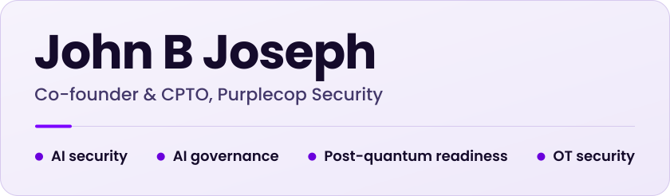</picture></a>

<a href="https://johnbjoseph-cybersec.github.io/"><picture><source media="(max-width: 600px) and (prefers-color-scheme: dark)" srcset="https://raw.githubusercontent.com/Johnbjoseph-cybersec/Johnbjoseph-cybersec/main/assets/dark/pill-website-m.svg?v=b48e0dab"><source media="(max-width: 600px)" srcset="https://raw.githubusercontent.com/Johnbjoseph-cybersec/Johnbjoseph-cybersec/main/assets/light/pill-website-m.svg?v=b48e0dab"><source media="(prefers-color-scheme: dark)" srcset="https://raw.githubusercontent.com/Johnbjoseph-cybersec/Johnbjoseph-cybersec/main/assets/dark/pill-website.svg?v=f9d62994"></picture></a><a href="https://grclab.purplecop.io"><picture><source media="(max-width: 600px) and (prefers-color-scheme: dark)" srcset="https://raw.githubusercontent.com/Johnbjoseph-cybersec/Johnbjoseph-cybersec/main/assets/dark/pill-lab-m.svg?v=d1c4ccca"><source media="(max-width: 600px)" srcset="https://raw.githubusercontent.com/Johnbjoseph-cybersec/Johnbjoseph-cybersec/main/assets/light/pill-lab-m.svg?v=d1c4ccca"><source media="(prefers-color-scheme: dark)" srcset="https://raw.githubusercontent.com/Johnbjoseph-cybersec/Johnbjoseph-cybersec/main/assets/dark/pill-lab.svg?v=23dad286"></picture></a><a href="https://www.youtube.com/@GRCMadeSimple"><picture><source media="(max-width: 600px) and (prefers-color-scheme: dark)" srcset="https://raw.githubusercontent.com/Johnbjoseph-cybersec/Johnbjoseph-cybersec/main/assets/dark/pill-youtube-m.svg?v=d2a58d19"><source media="(max-width: 600px)" srcset="https://raw.githubusercontent.com/Johnbjoseph-cybersec/Johnbjoseph-cybersec/main/assets/light/pill-youtube-m.svg?v=d2a58d19"><source media="(prefers-color-scheme: dark)" srcset="https://raw.githubusercontent.com/Johnbjoseph-cybersec/Johnbjoseph-cybersec/main/assets/dark/pill-youtube.svg?v=d94f8e14"></picture></a><a href="https://www.linkedin.com/newsletters/grc-made-simple-7493284804747251713/"><picture><source media="(max-width: 600px) and (prefers-color-scheme: dark)" srcset="https://raw.githubusercontent.com/Johnbjoseph-cybersec/Johnbjoseph-cybersec/main/assets/dark/pill-newsletter-m.svg?v=21a1fb37"><source media="(max-width: 600px)" srcset="https://raw.githubusercontent.com/Johnbjoseph-cybersec/Johnbjoseph-cybersec/main/assets/light/pill-newsletter-m.svg?v=21a1fb37"><source media="(prefers-color-scheme: dark)" srcset="https://raw.githubusercontent.com/Johnbjoseph-cybersec/Johnbjoseph-cybersec/main/assets/dark/pill-newsletter.svg?v=58048635"></picture></a><a href="https://www.linkedin.com/in/john-bj/"><picture><source media="(max-width: 600px) and (prefers-color-scheme: dark)" srcset="https://raw.githubusercontent.com/Johnbjoseph-cybersec/Johnbjoseph-cybersec/main/assets/dark/pill-linkedin-m.svg?v=7f5e6881"><source media="(max-width: 600px)" srcset="https://raw.githubusercontent.com/Johnbjoseph-cybersec/Johnbjoseph-cybersec/main/assets/light/pill-linkedin-m.svg?v=7f5e6881"><source media="(prefers-color-scheme: dark)" srcset="https://raw.githubusercontent.com/Johnbjoseph-cybersec/Johnbjoseph-cybersec/main/assets/dark/pill-linkedin.svg?v=fdc9ff2f"></picture></a>

<picture><source media="(max-width: 600px) and (prefers-color-scheme: dark)" srcset="https://raw.githubusercontent.com/Johnbjoseph-cybersec/Johnbjoseph-cybersec/main/assets/dark/ticker-m.svg?v=a6cecc5e"><source media="(max-width: 600px)" srcset="https://raw.githubusercontent.com/Johnbjoseph-cybersec/Johnbjoseph-cybersec/main/assets/light/ticker-m.svg?v=a6cecc5e"><source media="(prefers-color-scheme: dark)" srcset="https://raw.githubusercontent.com/Johnbjoseph-cybersec/Johnbjoseph-cybersec/main/assets/dark/ticker.svg?v=c13c99a6"></picture>

<picture><source media="(max-width: 600px) and (prefers-color-scheme: dark)" srcset="https://raw.githubusercontent.com/Johnbjoseph-cybersec/Johnbjoseph-cybersec/main/assets/dark/stats-m.svg?v=3f36d42d"><source media="(max-width: 600px)" srcset="https://raw.githubusercontent.com/Johnbjoseph-cybersec/Johnbjoseph-cybersec/main/assets/light/stats-m.svg?v=3f36d42d"><source media="(prefers-color-scheme: dark)" srcset="https://raw.githubusercontent.com/Johnbjoseph-cybersec/Johnbjoseph-cybersec/main/assets/dark/stats.svg?v=0c15b6ad"></picture>

<picture><source media="(max-width: 600px) and (prefers-color-scheme: dark)" srcset="https://raw.githubusercontent.com/Johnbjoseph-cybersec/Johnbjoseph-cybersec/main/assets/dark/intro-m.svg?v=20f5ec48"><source media="(max-width: 600px)" srcset="https://raw.githubusercontent.com/Johnbjoseph-cybersec/Johnbjoseph-cybersec/main/assets/light/intro-m.svg?v=20f5ec48"><source media="(prefers-color-scheme: dark)" srcset="https://raw.githubusercontent.com/Johnbjoseph-cybersec/Johnbjoseph-cybersec/main/assets/dark/intro.svg?v=ff8107d9"></picture>

<picture><source media="(max-width: 600px) and (prefers-color-scheme: dark)" srcset="https://raw.githubusercontent.com/Johnbjoseph-cybersec/Johnbjoseph-cybersec/main/assets/dark/sec-built-m.svg?v=7c87fa57"><source media="(max-width: 600px)" srcset="https://raw.githubusercontent.com/Johnbjoseph-cybersec/Johnbjoseph-cybersec/main/assets/light/sec-built-m.svg?v=f217bdfc"><source media="(prefers-color-scheme: dark)" srcset="https://raw.githubusercontent.com/Johnbjoseph-cybersec/Johnbjoseph-cybersec/main/assets/dark/sec-built.svg?v=fcfb8ee6"></picture>

<a href="https://grclab.purplecop.io"><picture><source media="(max-width: 600px) and (prefers-color-scheme: dark)" srcset="https://raw.githubusercontent.com/Johnbjoseph-cybersec/Johnbjoseph-cybersec/main/assets/dark/card-lab-m.svg?v=77519fdc"><source media="(max-width: 600px)" srcset="https://raw.githubusercontent.com/Johnbjoseph-cybersec/Johnbjoseph-cybersec/main/assets/light/card-lab-m.svg?v=77519fdc"><source media="(prefers-color-scheme: dark)" srcset="https://raw.githubusercontent.com/Johnbjoseph-cybersec/Johnbjoseph-cybersec/main/assets/dark/card-lab.svg?v=ce88ff91"></picture></a>

  <a href="https://github.com/Johnbjoseph-cybersec/rewindagents"><picture><source media="(prefers-color-scheme: dark)" srcset="https://raw.githubusercontent.com/Johnbjoseph-cybersec/Johnbjoseph-cybersec/main/assets/dark/card-rewindagents.svg?v=40bcaf08"></picture></a>
  <a href="https://github.com/Johnbjoseph-cybersec/india-ai-regulation-crosswalk"><picture><source media="(prefers-color-scheme: dark)" srcset="https://raw.githubusercontent.com/Johnbjoseph-cybersec/Johnbjoseph-cybersec/main/assets/dark/card-ai-crosswalk.svg?v=8c2ea690"></picture></a>

  <a href="https://github.com/Johnbjoseph-cybersec/india-ot-regulation-crosswalk"><picture><source media="(prefers-color-scheme: dark)" srcset="https://raw.githubusercontent.com/Johnbjoseph-cybersec/Johnbjoseph-cybersec/main/assets/dark/card-ot-crosswalk.svg?v=eb20e825"></picture></a>
  <a href="https://github.com/Johnbjoseph-cybersec/nist-800-82r4-ot-overlay-oscal"><picture><source media="(prefers-color-scheme: dark)" srcset="https://raw.githubusercontent.com/Johnbjoseph-cybersec/Johnbjoseph-cybersec/main/assets/dark/card-oscal-overlay.svg?v=51abfb67"></picture></a>

  <a href="https://github.com/Johnbjoseph-cybersec/inspect-oscal"><picture><source media="(prefers-color-scheme: dark)" srcset="https://raw.githubusercontent.com/Johnbjoseph-cybersec/Johnbjoseph-cybersec/main/assets/dark/card-inspect-oscal.svg?v=0ad36941"></picture></a>
  <a href="https://johnbjoseph-cybersec.github.io/grc-made-simple-templates/"><picture><source media="(prefers-color-scheme: dark)" srcset="https://raw.githubusercontent.com/Johnbjoseph-cybersec/Johnbjoseph-cybersec/main/assets/dark/card-templates.svg?v=a13a8132"></picture></a>

  <a href="https://github.com/Johnbjoseph-cybersec/mindledger"><picture><source media="(prefers-color-scheme: dark)" srcset="https://raw.githubusercontent.com/Johnbjoseph-cybersec/Johnbjoseph-cybersec/main/assets/dark/card-mindledger.svg?v=c6a38193"></picture></a>

Lab source: [Johnbjoseph-cybersec.github.io](https://github.com/Johnbjoseph-cybersec/Johnbjoseph-cybersec.github.io) · Template downloads: [AI System Inventory and Risk Register](https://johnbjoseph-cybersec.github.io/grc-made-simple-templates/templates/GRC-Made-Simple_AI-System-Inventory-and-Risk-Register.xlsx) · [Crypto Inventory and PQC Migration](https://johnbjoseph-cybersec.github.io/grc-made-simple-templates/templates/GRC-Made-Simple_Crypto-Inventory-and-PQC-Migration-Workbook.xlsx) · [AI Vendor Due-Diligence Questionnaire](https://johnbjoseph-cybersec.github.io/grc-made-simple-templates/templates/GRC-Made-Simple_AI-Vendor-Due-Diligence-Questionnaire.xlsx) · [DPDP Readiness Checklist](https://johnbjoseph-cybersec.github.io/grc-made-simple-templates/templates/GRC-Made-Simple_DPDP-Readiness-Checklist.xlsx)

<picture><source media="(max-width: 600px) and (prefers-color-scheme: dark)" srcset="https://raw.githubusercontent.com/Johnbjoseph-cybersec/Johnbjoseph-cybersec/main/assets/dark/sec-oss-m.svg?v=8f2a312b"><source media="(max-width: 600px)" srcset="https://raw.githubusercontent.com/Johnbjoseph-cybersec/Johnbjoseph-cybersec/main/assets/light/sec-oss-m.svg?v=bab42bcd"><source media="(prefers-color-scheme: dark)" srcset="https://raw.githubusercontent.com/Johnbjoseph-cybersec/Johnbjoseph-cybersec/main/assets/dark/sec-oss.svg?v=77f9c0bb"></picture>

<picture><source media="(max-width: 600px) and (prefers-color-scheme: dark)" srcset="https://raw.githubusercontent.com/Johnbjoseph-cybersec/Johnbjoseph-cybersec/main/assets/dark/chart-m.svg?v=de28f73b"><source media="(max-width: 600px)" srcset="https://raw.githubusercontent.com/Johnbjoseph-cybersec/Johnbjoseph-cybersec/main/assets/light/chart-m.svg?v=de28f73b"><source media="(prefers-color-scheme: dark)" srcset="https://raw.githubusercontent.com/Johnbjoseph-cybersec/Johnbjoseph-cybersec/main/assets/dark/chart.svg?v=8fb6f96f"></picture>

<picture><source media="(max-width: 600px) and (prefers-color-scheme: dark)" srcset="https://raw.githubusercontent.com/Johnbjoseph-cybersec/Johnbjoseph-cybersec/main/assets/dark/sub-merged-m.svg?v=16898466"><source media="(max-width: 600px)" srcset="https://raw.githubusercontent.com/Johnbjoseph-cybersec/Johnbjoseph-cybersec/main/assets/light/sub-merged-m.svg?v=2cf5d85a"><source media="(prefers-color-scheme: dark)" srcset="https://raw.githubusercontent.com/Johnbjoseph-cybersec/Johnbjoseph-cybersec/main/assets/dark/sub-merged.svg?v=28644401"></picture>

  <a href="https://github.com/wshobson/agents/pull/831"><picture><source media="(max-width: 600px) and (prefers-color-scheme: dark)" srcset="https://raw.githubusercontent.com/Johnbjoseph-cybersec/Johnbjoseph-cybersec/main/assets/rows/dark/wshobson-agents-831-m.svg?v=6f729838"><source media="(max-width: 600px)" srcset="https://raw.githubusercontent.com/Johnbjoseph-cybersec/Johnbjoseph-cybersec/main/assets/rows/light/wshobson-agents-831-m.svg?v=6f729838"><source media="(prefers-color-scheme: dark)" srcset="https://raw.githubusercontent.com/Johnbjoseph-cybersec/Johnbjoseph-cybersec/main/assets/rows/dark/wshobson-agents-831.svg?v=ba010073"></picture></a>
  <a href="https://github.com/w3c/did-resolution/pull/406"><picture><source media="(max-width: 600px) and (prefers-color-scheme: dark)" srcset="https://raw.githubusercontent.com/Johnbjoseph-cybersec/Johnbjoseph-cybersec/main/assets/rows/dark/w3c-did-resolution-360-m.svg?v=04adcac9"><source media="(max-width: 600px)" srcset="https://raw.githubusercontent.com/Johnbjoseph-cybersec/Johnbjoseph-cybersec/main/assets/rows/light/w3c-did-resolution-360-m.svg?v=04adcac9"><source media="(prefers-color-scheme: dark)" srcset="https://raw.githubusercontent.com/Johnbjoseph-cybersec/Johnbjoseph-cybersec/main/assets/rows/dark/w3c-did-resolution-360.svg?v=ca4f5b03"></picture></a>
  <a href="https://github.com/OWASP/www-project-ai-security-and-privacy-guide/pull/285"><picture><source media="(max-width: 600px) and (prefers-color-scheme: dark)" srcset="https://raw.githubusercontent.com/Johnbjoseph-cybersec/Johnbjoseph-cybersec/main/assets/rows/dark/www-project-ai-security-and-privacy-guide-285-m.svg?v=30b8a55d"><source media="(max-width: 600px)" srcset="https://raw.githubusercontent.com/Johnbjoseph-cybersec/Johnbjoseph-cybersec/main/assets/rows/light/www-project-ai-security-and-privacy-guide-285-m.svg?v=30b8a55d"><source media="(prefers-color-scheme: dark)" srcset="https://raw.githubusercontent.com/Johnbjoseph-cybersec/Johnbjoseph-cybersec/main/assets/rows/dark/www-project-ai-security-and-privacy-guide-285.svg?v=825569f6"></picture></a>
  <a href="https://github.com/google/cybernetic-agent-governance-engine/pull/777"><picture><source media="(max-width: 600px) and (prefers-color-scheme: dark)" srcset="https://raw.githubusercontent.com/Johnbjoseph-cybersec/Johnbjoseph-cybersec/main/assets/rows/dark/cybernetic-agent-governance-engine-777-m.svg?v=df8bbc1f"><source media="(max-width: 600px)" srcset="https://raw.githubusercontent.com/Johnbjoseph-cybersec/Johnbjoseph-cybersec/main/assets/rows/light/cybernetic-agent-governance-engine-777-m.svg?v=df8bbc1f"><source media="(prefers-color-scheme: dark)" srcset="https://raw.githubusercontent.com/Johnbjoseph-cybersec/Johnbjoseph-cybersec/main/assets/rows/dark/cybernetic-agent-governance-engine-777.svg?v=0a969e31"></picture></a>
  <a href="https://github.com/msoedov/agentic_security/pull/385"><picture><source media="(max-width: 600px) and (prefers-color-scheme: dark)" srcset="https://raw.githubusercontent.com/Johnbjoseph-cybersec/Johnbjoseph-cybersec/main/assets/rows/dark/agentic_security-385-m.svg?v=192e7a22"><source media="(max-width: 600px)" srcset="https://raw.githubusercontent.com/Johnbjoseph-cybersec/Johnbjoseph-cybersec/main/assets/rows/light/agentic_security-385-m.svg?v=192e7a22"><source media="(prefers-color-scheme: dark)" srcset="https://raw.githubusercontent.com/Johnbjoseph-cybersec/Johnbjoseph-cybersec/main/assets/rows/dark/agentic_security-385.svg?v=7871fd95"></picture></a>
  <a href="https://github.com/Tencent/AI-Infra-Guard/pull/768"><picture><source media="(max-width: 600px) and (prefers-color-scheme: dark)" srcset="https://raw.githubusercontent.com/Johnbjoseph-cybersec/Johnbjoseph-cybersec/main/assets/rows/dark/AI-Infra-Guard-768-m.svg?v=82bc1eec"><source media="(max-width: 600px)" srcset="https://raw.githubusercontent.com/Johnbjoseph-cybersec/Johnbjoseph-cybersec/main/assets/rows/light/AI-Infra-Guard-768-m.svg?v=82bc1eec"><source media="(prefers-color-scheme: dark)" srcset="https://raw.githubusercontent.com/Johnbjoseph-cybersec/Johnbjoseph-cybersec/main/assets/rows/dark/AI-Infra-Guard-768.svg?v=59ccfaaa"></picture></a>
  <a href="https://github.com/google/cybernetic-agent-governance-engine/pull/763"><picture><source media="(max-width: 600px) and (prefers-color-scheme: dark)" srcset="https://raw.githubusercontent.com/Johnbjoseph-cybersec/Johnbjoseph-cybersec/main/assets/rows/dark/cybernetic-agent-governance-engine-763-m.svg?v=14c7506b"><source media="(max-width: 600px)" srcset="https://raw.githubusercontent.com/Johnbjoseph-cybersec/Johnbjoseph-cybersec/main/assets/rows/light/cybernetic-agent-governance-engine-763-m.svg?v=14c7506b"><source media="(prefers-color-scheme: dark)" srcset="https://raw.githubusercontent.com/Johnbjoseph-cybersec/Johnbjoseph-cybersec/main/assets/rows/dark/cybernetic-agent-governance-engine-763.svg?v=1d1924a9"></picture></a>
  <a href="https://github.com/OWASP/wstg/pull/1680"><picture><source media="(max-width: 600px) and (prefers-color-scheme: dark)" srcset="https://raw.githubusercontent.com/Johnbjoseph-cybersec/Johnbjoseph-cybersec/main/assets/rows/dark/wstg-1680-m.svg?v=0fe45f5b"><source media="(max-width: 600px)" srcset="https://raw.githubusercontent.com/Johnbjoseph-cybersec/Johnbjoseph-cybersec/main/assets/rows/light/wstg-1680-m.svg?v=0fe45f5b"><source media="(prefers-color-scheme: dark)" srcset="https://raw.githubusercontent.com/Johnbjoseph-cybersec/Johnbjoseph-cybersec/main/assets/rows/dark/wstg-1680.svg?v=47dc4b8b"></picture></a>
  <a href="https://github.com/Balanov/uncut/pull/8"><picture><source media="(max-width: 600px) and (prefers-color-scheme: dark)" srcset="https://raw.githubusercontent.com/Johnbjoseph-cybersec/Johnbjoseph-cybersec/main/assets/rows/dark/uncut-8-m.svg?v=c7ce9bb6"><source media="(max-width: 600px)" srcset="https://raw.githubusercontent.com/Johnbjoseph-cybersec/Johnbjoseph-cybersec/main/assets/rows/light/uncut-8-m.svg?v=c7ce9bb6"><source media="(prefers-color-scheme: dark)" srcset="https://raw.githubusercontent.com/Johnbjoseph-cybersec/Johnbjoseph-cybersec/main/assets/rows/dark/uncut-8.svg?v=4bb7dffe"></picture></a>
  <a href="https://github.com/OWASP/pytm/pull/394"><picture><source media="(max-width: 600px) and (prefers-color-scheme: dark)" srcset="https://raw.githubusercontent.com/Johnbjoseph-cybersec/Johnbjoseph-cybersec/main/assets/rows/dark/pytm-394-m.svg?v=1eb99a3a"><source media="(max-width: 600px)" srcset="https://raw.githubusercontent.com/Johnbjoseph-cybersec/Johnbjoseph-cybersec/main/assets/rows/light/pytm-394-m.svg?v=1eb99a3a"><source media="(prefers-color-scheme: dark)" srcset="https://raw.githubusercontent.com/Johnbjoseph-cybersec/Johnbjoseph-cybersec/main/assets/rows/dark/pytm-394.svg?v=3a07eb97"></picture></a>
  <a href="https://github.com/Balanov/uncut/pull/6"><picture><source media="(max-width: 600px) and (prefers-color-scheme: dark)" srcset="https://raw.githubusercontent.com/Johnbjoseph-cybersec/Johnbjoseph-cybersec/main/assets/rows/dark/uncut-6-m.svg?v=63066f1d"><source media="(max-width: 600px)" srcset="https://raw.githubusercontent.com/Johnbjoseph-cybersec/Johnbjoseph-cybersec/main/assets/rows/light/uncut-6-m.svg?v=63066f1d"><source media="(prefers-color-scheme: dark)" srcset="https://raw.githubusercontent.com/Johnbjoseph-cybersec/Johnbjoseph-cybersec/main/assets/rows/dark/uncut-6.svg?v=16cb91b4"></picture></a>
  <a href="https://github.com/only-cli/oc/pull/137"><picture><source media="(max-width: 600px) and (prefers-color-scheme: dark)" srcset="https://raw.githubusercontent.com/Johnbjoseph-cybersec/Johnbjoseph-cybersec/main/assets/rows/dark/oc-137-m.svg?v=0d61c732"><source media="(max-width: 600px)" srcset="https://raw.githubusercontent.com/Johnbjoseph-cybersec/Johnbjoseph-cybersec/main/assets/rows/light/oc-137-m.svg?v=0d61c732"><source media="(prefers-color-scheme: dark)" srcset="https://raw.githubusercontent.com/Johnbjoseph-cybersec/Johnbjoseph-cybersec/main/assets/rows/dark/oc-137.svg?v=7b5612c8"></picture></a>
  <a href="https://github.com/UKGovernmentBEIS/inspect_ai/pull/6545"><picture><source media="(max-width: 600px) and (prefers-color-scheme: dark)" srcset="https://raw.githubusercontent.com/Johnbjoseph-cybersec/Johnbjoseph-cybersec/main/assets/rows/dark/inspect_ai-6545-m.svg?v=cf733b4c"><source media="(max-width: 600px)" srcset="https://raw.githubusercontent.com/Johnbjoseph-cybersec/Johnbjoseph-cybersec/main/assets/rows/light/inspect_ai-6545-m.svg?v=cf733b4c"><source media="(prefers-color-scheme: dark)" srcset="https://raw.githubusercontent.com/Johnbjoseph-cybersec/Johnbjoseph-cybersec/main/assets/rows/dark/inspect_ai-6545.svg?v=60ce1caa"></picture></a>
  <a href="https://github.com/punkpeye/fastmcp/pull/526"><picture><source media="(max-width: 600px) and (prefers-color-scheme: dark)" srcset="https://raw.githubusercontent.com/Johnbjoseph-cybersec/Johnbjoseph-cybersec/main/assets/rows/dark/fastmcp-526-m.svg?v=cf1efc99"><source media="(max-width: 600px)" srcset="https://raw.githubusercontent.com/Johnbjoseph-cybersec/Johnbjoseph-cybersec/main/assets/rows/light/fastmcp-526-m.svg?v=cf1efc99"><source media="(prefers-color-scheme: dark)" srcset="https://raw.githubusercontent.com/Johnbjoseph-cybersec/Johnbjoseph-cybersec/main/assets/rows/dark/fastmcp-526.svg?v=9275e4c5"></picture></a>
  <a href="https://github.com/cdxgen/cdxgen/issues/4794"><picture><source media="(max-width: 600px) and (prefers-color-scheme: dark)" srcset="https://raw.githubusercontent.com/Johnbjoseph-cybersec/Johnbjoseph-cybersec/main/assets/rows/dark/cdxgen-4794-m.svg?v=8a6f62c1"><source media="(max-width: 600px)" srcset="https://raw.githubusercontent.com/Johnbjoseph-cybersec/Johnbjoseph-cybersec/main/assets/rows/light/cdxgen-4794-m.svg?v=8a6f62c1"><source media="(prefers-color-scheme: dark)" srcset="https://raw.githubusercontent.com/Johnbjoseph-cybersec/Johnbjoseph-cybersec/main/assets/rows/dark/cdxgen-4794.svg?v=69895019"></picture></a>
  <a href="https://github.com/cdxgen/cdxgen/issues/4793"><picture><source media="(max-width: 600px) and (prefers-color-scheme: dark)" srcset="https://raw.githubusercontent.com/Johnbjoseph-cybersec/Johnbjoseph-cybersec/main/assets/rows/dark/cdxgen-4793-m.svg?v=a3ed52cc"><source media="(max-width: 600px)" srcset="https://raw.githubusercontent.com/Johnbjoseph-cybersec/Johnbjoseph-cybersec/main/assets/rows/light/cdxgen-4793-m.svg?v=a3ed52cc"><source media="(prefers-color-scheme: dark)" srcset="https://raw.githubusercontent.com/Johnbjoseph-cybersec/Johnbjoseph-cybersec/main/assets/rows/dark/cdxgen-4793.svg?v=5d7966dd"></picture></a>
  <a href="https://github.com/OWASP/CheatSheetSeries/pull/2963"><picture><source media="(max-width: 600px) and (prefers-color-scheme: dark)" srcset="https://raw.githubusercontent.com/Johnbjoseph-cybersec/Johnbjoseph-cybersec/main/assets/rows/dark/CheatSheetSeries-2963-m.svg?v=f14d361a"><source media="(max-width: 600px)" srcset="https://raw.githubusercontent.com/Johnbjoseph-cybersec/Johnbjoseph-cybersec/main/assets/rows/light/CheatSheetSeries-2963-m.svg?v=f14d361a"><source media="(prefers-color-scheme: dark)" srcset="https://raw.githubusercontent.com/Johnbjoseph-cybersec/Johnbjoseph-cybersec/main/assets/rows/dark/CheatSheetSeries-2963.svg?v=b1892c08"></picture></a>
  <a href="https://github.com/caru-ini/stack-diagram/pull/8"><picture><source media="(max-width: 600px) and (prefers-color-scheme: dark)" srcset="https://raw.githubusercontent.com/Johnbjoseph-cybersec/Johnbjoseph-cybersec/main/assets/rows/dark/stack-diagram-8-m.svg?v=b095ac37"><source media="(max-width: 600px)" srcset="https://raw.githubusercontent.com/Johnbjoseph-cybersec/Johnbjoseph-cybersec/main/assets/rows/light/stack-diagram-8-m.svg?v=b095ac37"><source media="(prefers-color-scheme: dark)" srcset="https://raw.githubusercontent.com/Johnbjoseph-cybersec/Johnbjoseph-cybersec/main/assets/rows/dark/stack-diagram-8.svg?v=f13a6d38"></picture></a>
  <a href="https://github.com/h4ckf0r0day/obscura/issues/1531"><picture><source media="(max-width: 600px) and (prefers-color-scheme: dark)" srcset="https://raw.githubusercontent.com/Johnbjoseph-cybersec/Johnbjoseph-cybersec/main/assets/rows/dark/obscura-1531-m.svg?v=d5c32b16"><source media="(max-width: 600px)" srcset="https://raw.githubusercontent.com/Johnbjoseph-cybersec/Johnbjoseph-cybersec/main/assets/rows/light/obscura-1531-m.svg?v=d5c32b16"><source media="(prefers-color-scheme: dark)" srcset="https://raw.githubusercontent.com/Johnbjoseph-cybersec/Johnbjoseph-cybersec/main/assets/rows/dark/obscura-1531.svg?v=80debfdb"></picture></a>
  <a href="https://github.com/h4ckf0r0day/obscura/pull/1513"><picture><source media="(max-width: 600px) and (prefers-color-scheme: dark)" srcset="https://raw.githubusercontent.com/Johnbjoseph-cybersec/Johnbjoseph-cybersec/main/assets/rows/dark/obscura-1513-m.svg?v=eeeed75a"><source media="(max-width: 600px)" srcset="https://raw.githubusercontent.com/Johnbjoseph-cybersec/Johnbjoseph-cybersec/main/assets/rows/light/obscura-1513-m.svg?v=eeeed75a"><source media="(prefers-color-scheme: dark)" srcset="https://raw.githubusercontent.com/Johnbjoseph-cybersec/Johnbjoseph-cybersec/main/assets/rows/dark/obscura-1513.svg?v=19895493"></picture></a>
  <a href="https://github.com/wshobson/agents/issues/821"><picture><source media="(max-width: 600px) and (prefers-color-scheme: dark)" srcset="https://raw.githubusercontent.com/Johnbjoseph-cybersec/Johnbjoseph-cybersec/main/assets/rows/dark/wshobson-agents-821-m.svg?v=ace7858d"><source media="(max-width: 600px)" srcset="https://raw.githubusercontent.com/Johnbjoseph-cybersec/Johnbjoseph-cybersec/main/assets/rows/light/wshobson-agents-821-m.svg?v=ace7858d"><source media="(prefers-color-scheme: dark)" srcset="https://raw.githubusercontent.com/Johnbjoseph-cybersec/Johnbjoseph-cybersec/main/assets/rows/dark/wshobson-agents-821.svg?v=762606c5"></picture></a>
  <a href="https://github.com/shorlist/shorlist/pull/2"><picture><source media="(max-width: 600px) and (prefers-color-scheme: dark)" srcset="https://raw.githubusercontent.com/Johnbjoseph-cybersec/Johnbjoseph-cybersec/main/assets/rows/dark/shorlist-2-m.svg?v=07590633"><source media="(max-width: 600px)" srcset="https://raw.githubusercontent.com/Johnbjoseph-cybersec/Johnbjoseph-cybersec/main/assets/rows/light/shorlist-2-m.svg?v=07590633"><source media="(prefers-color-scheme: dark)" srcset="https://raw.githubusercontent.com/Johnbjoseph-cybersec/Johnbjoseph-cybersec/main/assets/rows/dark/shorlist-2.svg?v=abca08eb"></picture></a>
  <a href="https://github.com/Sushegaad/Claude-Skills-Governance-Risk-and-Compliance/issues/62"><picture><source media="(max-width: 600px) and (prefers-color-scheme: dark)" srcset="https://raw.githubusercontent.com/Johnbjoseph-cybersec/Johnbjoseph-cybersec/main/assets/rows/dark/grc-skills-62-m.svg?v=07499b76"><source media="(max-width: 600px)" srcset="https://raw.githubusercontent.com/Johnbjoseph-cybersec/Johnbjoseph-cybersec/main/assets/rows/light/grc-skills-62-m.svg?v=07499b76"><source media="(prefers-color-scheme: dark)" srcset="https://raw.githubusercontent.com/Johnbjoseph-cybersec/Johnbjoseph-cybersec/main/assets/rows/dark/grc-skills-62.svg?v=44ee84bc"></picture></a>
  <a href="https://github.com/alirezarezvani/claude-skills/pull/1121"><picture><source media="(max-width: 600px) and (prefers-color-scheme: dark)" srcset="https://raw.githubusercontent.com/Johnbjoseph-cybersec/Johnbjoseph-cybersec/main/assets/rows/dark/claude-skills-1121-m.svg?v=f1e96804"><source media="(max-width: 600px)" srcset="https://raw.githubusercontent.com/Johnbjoseph-cybersec/Johnbjoseph-cybersec/main/assets/rows/light/claude-skills-1121-m.svg?v=f1e96804"><source media="(prefers-color-scheme: dark)" srcset="https://raw.githubusercontent.com/Johnbjoseph-cybersec/Johnbjoseph-cybersec/main/assets/rows/dark/claude-skills-1121.svg?v=dd7455c1"></picture></a>
  <a href="https://github.com/StanimirTenev/qrp-mcp/pull/15"><picture><source media="(max-width: 600px) and (prefers-color-scheme: dark)" srcset="https://raw.githubusercontent.com/Johnbjoseph-cybersec/Johnbjoseph-cybersec/main/assets/rows/dark/qrp-mcp-15-m.svg?v=018d466d"><source media="(max-width: 600px)" srcset="https://raw.githubusercontent.com/Johnbjoseph-cybersec/Johnbjoseph-cybersec/main/assets/rows/light/qrp-mcp-15-m.svg?v=018d466d"><source media="(prefers-color-scheme: dark)" srcset="https://raw.githubusercontent.com/Johnbjoseph-cybersec/Johnbjoseph-cybersec/main/assets/rows/dark/qrp-mcp-15.svg?v=38c5b2d3"></picture></a>
  <a href="https://github.com/sbom-tool/sbom-tools/pull/450"><picture><source media="(max-width: 600px) and (prefers-color-scheme: dark)" srcset="https://raw.githubusercontent.com/Johnbjoseph-cybersec/Johnbjoseph-cybersec/main/assets/rows/dark/sbom-tools-450-m.svg?v=1479cbb9"><source media="(max-width: 600px)" srcset="https://raw.githubusercontent.com/Johnbjoseph-cybersec/Johnbjoseph-cybersec/main/assets/rows/light/sbom-tools-450-m.svg?v=1479cbb9"><source media="(prefers-color-scheme: dark)" srcset="https://raw.githubusercontent.com/Johnbjoseph-cybersec/Johnbjoseph-cybersec/main/assets/rows/dark/sbom-tools-450.svg?v=0a23b0fd"></picture></a>

<picture><source media="(max-width: 600px) and (prefers-color-scheme: dark)" srcset="https://raw.githubusercontent.com/Johnbjoseph-cybersec/Johnbjoseph-cybersec/main/assets/dark/sub-flagship-m.svg?v=0fac09ab"><source media="(max-width: 600px)" srcset="https://raw.githubusercontent.com/Johnbjoseph-cybersec/Johnbjoseph-cybersec/main/assets/light/sub-flagship-m.svg?v=cda16124"><source media="(prefers-color-scheme: dark)" srcset="https://raw.githubusercontent.com/Johnbjoseph-cybersec/Johnbjoseph-cybersec/main/assets/dark/sub-flagship.svg?v=ec84fdfe"></picture>

  <a href="https://github.com/promptfoo/promptfoo/pull/12396"><picture><source media="(max-width: 600px) and (prefers-color-scheme: dark)" srcset="https://raw.githubusercontent.com/Johnbjoseph-cybersec/Johnbjoseph-cybersec/main/assets/rows/dark/promptfoo-12396-m.svg?v=cff92564"><source media="(max-width: 600px)" srcset="https://raw.githubusercontent.com/Johnbjoseph-cybersec/Johnbjoseph-cybersec/main/assets/rows/light/promptfoo-12396-m.svg?v=cff92564"><source media="(prefers-color-scheme: dark)" srcset="https://raw.githubusercontent.com/Johnbjoseph-cybersec/Johnbjoseph-cybersec/main/assets/rows/dark/promptfoo-12396.svg?v=a3f22deb"></picture></a>
  <a href="https://github.com/finos/ai-governance-framework/pull/449"><picture><source media="(max-width: 600px) and (prefers-color-scheme: dark)" srcset="https://raw.githubusercontent.com/Johnbjoseph-cybersec/Johnbjoseph-cybersec/main/assets/rows/dark/ai-governance-framework-449-m.svg?v=94c753a5"><source media="(max-width: 600px)" srcset="https://raw.githubusercontent.com/Johnbjoseph-cybersec/Johnbjoseph-cybersec/main/assets/rows/light/ai-governance-framework-449-m.svg?v=94c753a5"><source media="(prefers-color-scheme: dark)" srcset="https://raw.githubusercontent.com/Johnbjoseph-cybersec/Johnbjoseph-cybersec/main/assets/rows/dark/ai-governance-framework-449.svg?v=f1eba8aa"></picture></a>
  <a href="https://github.com/aquasecurity/trivy/discussions/11625"><picture><source media="(max-width: 600px) and (prefers-color-scheme: dark)" srcset="https://raw.githubusercontent.com/Johnbjoseph-cybersec/Johnbjoseph-cybersec/main/assets/rows/dark/trivy-discussion-11625-m.svg?v=f4bfd17e"><source media="(max-width: 600px)" srcset="https://raw.githubusercontent.com/Johnbjoseph-cybersec/Johnbjoseph-cybersec/main/assets/rows/light/trivy-discussion-11625-m.svg?v=f4bfd17e"><source media="(prefers-color-scheme: dark)" srcset="https://raw.githubusercontent.com/Johnbjoseph-cybersec/Johnbjoseph-cybersec/main/assets/rows/dark/trivy-discussion-11625.svg?v=75f37b3e"></picture></a>
  <a href="https://github.com/google/osv-scanner/issues/97#issuecomment-6818032744"><picture><source media="(max-width: 600px) and (prefers-color-scheme: dark)" srcset="https://raw.githubusercontent.com/Johnbjoseph-cybersec/Johnbjoseph-cybersec/main/assets/rows/dark/osv-scanner-97-m.svg?v=4885c9e7"><source media="(max-width: 600px)" srcset="https://raw.githubusercontent.com/Johnbjoseph-cybersec/Johnbjoseph-cybersec/main/assets/rows/light/osv-scanner-97-m.svg?v=4885c9e7"><source media="(prefers-color-scheme: dark)" srcset="https://raw.githubusercontent.com/Johnbjoseph-cybersec/Johnbjoseph-cybersec/main/assets/rows/dark/osv-scanner-97.svg?v=6cbe336f"></picture></a>
  <a href="https://github.com/microsoft/agent-governance-toolkit/discussions/4560#discussioncomment-19729679"><picture><source media="(max-width: 600px) and (prefers-color-scheme: dark)" srcset="https://raw.githubusercontent.com/Johnbjoseph-cybersec/Johnbjoseph-cybersec/main/assets/rows/dark/agent-governance-toolkit-4560-m.svg?v=060ba55c"><source media="(max-width: 600px)" srcset="https://raw.githubusercontent.com/Johnbjoseph-cybersec/Johnbjoseph-cybersec/main/assets/rows/light/agent-governance-toolkit-4560-m.svg?v=060ba55c"><source media="(prefers-color-scheme: dark)" srcset="https://raw.githubusercontent.com/Johnbjoseph-cybersec/Johnbjoseph-cybersec/main/assets/rows/dark/agent-governance-toolkit-4560.svg?v=a468f321"></picture></a>
  <a href="https://github.com/google/adk-python/pull/8237"><picture><source media="(max-width: 600px) and (prefers-color-scheme: dark)" srcset="https://raw.githubusercontent.com/Johnbjoseph-cybersec/Johnbjoseph-cybersec/main/assets/rows/dark/google-adk-python-8237-m.svg?v=cd9eb6e7"><source media="(max-width: 600px)" srcset="https://raw.githubusercontent.com/Johnbjoseph-cybersec/Johnbjoseph-cybersec/main/assets/rows/light/google-adk-python-8237-m.svg?v=cd9eb6e7"><source media="(prefers-color-scheme: dark)" srcset="https://raw.githubusercontent.com/Johnbjoseph-cybersec/Johnbjoseph-cybersec/main/assets/rows/dark/google-adk-python-8237.svg?v=77f3bb16"></picture></a>
  <a href="https://github.com/google/cybernetic-agent-governance-engine/pull/812"><picture><source media="(max-width: 600px) and (prefers-color-scheme: dark)" srcset="https://raw.githubusercontent.com/Johnbjoseph-cybersec/Johnbjoseph-cybersec/main/assets/rows/dark/cybernetic-agent-governance-engine-812-m.svg?v=c0944995"><source media="(max-width: 600px)" srcset="https://raw.githubusercontent.com/Johnbjoseph-cybersec/Johnbjoseph-cybersec/main/assets/rows/light/cybernetic-agent-governance-engine-812-m.svg?v=c0944995"><source media="(prefers-color-scheme: dark)" srcset="https://raw.githubusercontent.com/Johnbjoseph-cybersec/Johnbjoseph-cybersec/main/assets/rows/dark/cybernetic-agent-governance-engine-812.svg?v=0b16fe61"></picture></a>
  <a href="https://github.com/OWASP/ASVS/issues/3361#issuecomment-6981667854"><picture><source media="(max-width: 600px) and (prefers-color-scheme: dark)" srcset="https://raw.githubusercontent.com/Johnbjoseph-cybersec/Johnbjoseph-cybersec/main/assets/rows/dark/asvs-3361-proposal-m.svg?v=86d0c07f"><source media="(max-width: 600px)" srcset="https://raw.githubusercontent.com/Johnbjoseph-cybersec/Johnbjoseph-cybersec/main/assets/rows/light/asvs-3361-proposal-m.svg?v=86d0c07f"><source media="(prefers-color-scheme: dark)" srcset="https://raw.githubusercontent.com/Johnbjoseph-cybersec/Johnbjoseph-cybersec/main/assets/rows/dark/asvs-3361-proposal.svg?v=02c1cf2a"></picture></a>

Open means submitted and under review, not merged. [Every public PR I have opened](https://github.com/search?q=author%3AJohnbjoseph-cybersec+is%3Apr+is%3Apublic+-user%3AJohnbjoseph-cybersec&type=pullrequests). Ledger status as of 2026-11-19.

<picture><source media="(max-width: 600px) and (prefers-color-scheme: dark)" srcset="https://raw.githubusercontent.com/Johnbjoseph-cybersec/Johnbjoseph-cybersec/main/assets/dark/sec-focus-m.svg?v=9f6e2f0c"><source media="(max-width: 600px)" srcset="https://raw.githubusercontent.com/Johnbjoseph-cybersec/Johnbjoseph-cybersec/main/assets/light/sec-focus-m.svg?v=69d29689"><source media="(prefers-color-scheme: dark)" srcset="https://raw.githubusercontent.com/Johnbjoseph-cybersec/Johnbjoseph-cybersec/main/assets/dark/sec-focus.svg?v=6232a318"></picture>

  <picture><source media="(prefers-color-scheme: dark)" srcset="https://raw.githubusercontent.com/Johnbjoseph-cybersec/Johnbjoseph-cybersec/main/assets/dark/focus-ai-security.svg?v=895cf8f0"></picture>
  <picture><source media="(prefers-color-scheme: dark)" srcset="https://raw.githubusercontent.com/Johnbjoseph-cybersec/Johnbjoseph-cybersec/main/assets/dark/focus-ai-governance.svg?v=c1627a21">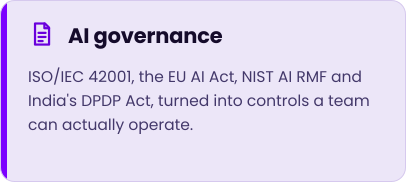</picture>
  <picture><source media="(prefers-color-scheme: dark)" srcset="https://raw.githubusercontent.com/Johnbjoseph-cybersec/Johnbjoseph-cybersec/main/assets/dark/focus-pqc.svg?v=0baa4664"></picture>
  <picture><source media="(prefers-color-scheme: dark)" srcset="https://raw.githubusercontent.com/Johnbjoseph-cybersec/Johnbjoseph-cybersec/main/assets/dark/focus-grc-eng.svg?v=1922bb2d"></picture>

  <picture><source media="(prefers-color-scheme: dark)" srcset="https://raw.githubusercontent.com/Johnbjoseph-cybersec/Johnbjoseph-cybersec/main/assets/dark/panel-credentials.svg?v=4e117575"></picture>
  <a href="https://grclab.purplecop.io"><picture><source media="(prefers-color-scheme: dark)" srcset="https://raw.githubusercontent.com/Johnbjoseph-cybersec/Johnbjoseph-cybersec/main/assets/dark/panel-teaching.svg?v=d2e9dc0a"></picture></a>

<picture><source media="(max-width: 600px) and (prefers-color-scheme: dark)" srcset="https://raw.githubusercontent.com/Johnbjoseph-cybersec/Johnbjoseph-cybersec/main/assets/dark/sec-speaking-m.svg?v=48d96d98"><source media="(max-width: 600px)" srcset="https://raw.githubusercontent.com/Johnbjoseph-cybersec/Johnbjoseph-cybersec/main/assets/light/sec-speaking-m.svg?v=5c97887f"><source media="(prefers-color-scheme: dark)" srcset="https://raw.githubusercontent.com/Johnbjoseph-cybersec/Johnbjoseph-cybersec/main/assets/dark/sec-speaking.svg?v=97ecff9d"></picture>

<picture><source media="(max-width: 600px) and (prefers-color-scheme: dark)" srcset="https://raw.githubusercontent.com/Johnbjoseph-cybersec/Johnbjoseph-cybersec/main/assets/dark/speaking-m.svg?v=7a4f75a7"><source media="(max-width: 600px)" srcset="https://raw.githubusercontent.com/Johnbjoseph-cybersec/Johnbjoseph-cybersec/main/assets/light/speaking-m.svg?v=7a4f75a7"><source media="(prefers-color-scheme: dark)" srcset="https://raw.githubusercontent.com/Johnbjoseph-cybersec/Johnbjoseph-cybersec/main/assets/dark/speaking.svg?v=cc81c8df"></picture>

<picture><source media="(max-width: 600px) and (prefers-color-scheme: dark)" srcset="https://raw.githubusercontent.com/Johnbjoseph-cybersec/Johnbjoseph-cybersec/main/assets/dark/foot-m.svg?v=e983e83a"><source media="(max-width: 600px)" srcset="https://raw.githubusercontent.com/Johnbjoseph-cybersec/Johnbjoseph-cybersec/main/assets/light/foot-m.svg?v=3d799416"><source media="(prefers-color-scheme: dark)" srcset="https://raw.githubusercontent.com/Johnbjoseph-cybersec/Johnbjoseph-cybersec/main/assets/dark/foot.svg?v=7c0a51b4"></picture>

<a href="https://johnbjoseph-cybersec.github.io/"><picture><source media="(max-width: 600px) and (prefers-color-scheme: dark)" srcset="https://raw.githubusercontent.com/Johnbjoseph-cybersec/Johnbjoseph-cybersec/main/assets/dark/pfoot-website-m.svg?v=16deca60"><source media="(max-width: 600px)" srcset="https://raw.githubusercontent.com/Johnbjoseph-cybersec/Johnbjoseph-cybersec/main/assets/light/pfoot-website-m.svg?v=16deca60"><source media="(prefers-color-scheme: dark)" srcset="https://raw.githubusercontent.com/Johnbjoseph-cybersec/Johnbjoseph-cybersec/main/assets/dark/pfoot-website.svg?v=90e7dc48"></picture></a><a href="https://www.linkedin.com/in/john-bj/"><picture><source media="(max-width: 600px) and (prefers-color-scheme: dark)" srcset="https://raw.githubusercontent.com/Johnbjoseph-cybersec/Johnbjoseph-cybersec/main/assets/dark/pfoot-linkedin-m.svg?v=7e49faae"><source media="(max-width: 600px)" srcset="https://raw.githubusercontent.com/Johnbjoseph-cybersec/Johnbjoseph-cybersec/main/assets/light/pfoot-linkedin-m.svg?v=7e49faae"><source media="(prefers-color-scheme: dark)" srcset="https://raw.githubusercontent.com/Johnbjoseph-cybersec/Johnbjoseph-cybersec/main/assets/dark/pfoot-linkedin.svg?v=514b2477"></picture></a><a href="https://www.youtube.com/@GRCMadeSimple"><picture><source media="(max-width: 600px) and (prefers-color-scheme: dark)" srcset="https://raw.githubusercontent.com/Johnbjoseph-cybersec/Johnbjoseph-cybersec/main/assets/dark/pfoot-youtube-m.svg?v=a748cbe6"><source media="(max-width: 600px)" srcset="https://raw.githubusercontent.com/Johnbjoseph-cybersec/Johnbjoseph-cybersec/main/assets/light/pfoot-youtube-m.svg?v=a748cbe6"><source media="(prefers-color-scheme: dark)" srcset="https://raw.githubusercontent.com/Johnbjoseph-cybersec/Johnbjoseph-cybersec/main/assets/dark/pfoot-youtube.svg?v=3dc1203b"></picture></a>

